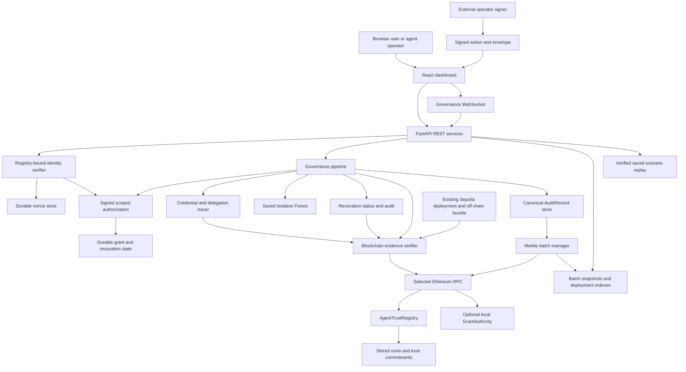
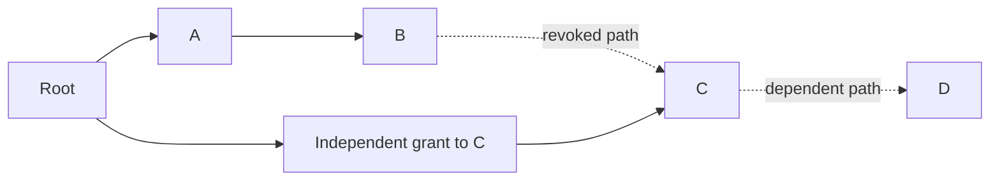
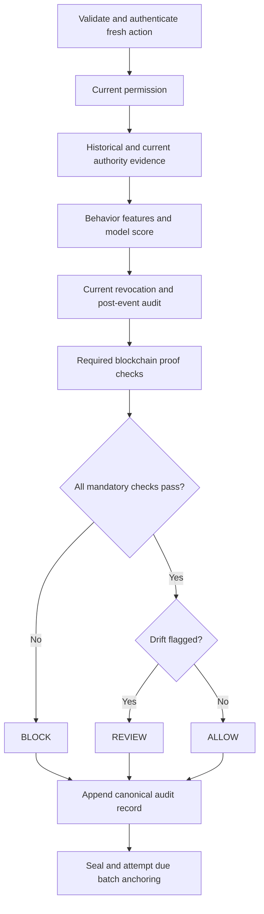
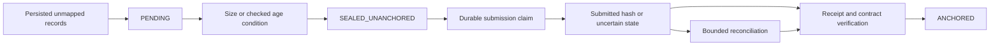
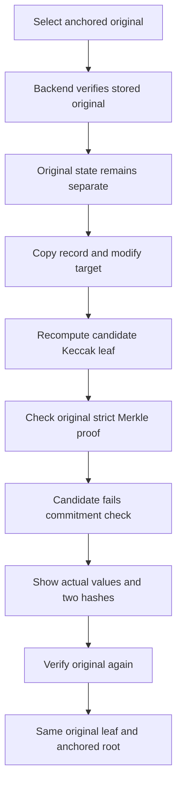
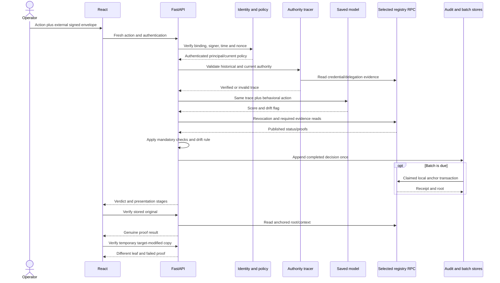

# ChainGuard-AI — Complete Project Explanation
## A technical handbook, code-reading guide and viva resource

**Project:** Blockchain-Anchored Trust and Delegation Framework for Autonomous AI Agents.

**Implementation inspected:** `main`, commit `157ab5e08b284610df344a20ef2e547618f794cb`.

**Documentation review:** 20 October 2026. This handbook accompanies the [installation guide](../README.md).

This document explains the code that exists, not an idealized proposal. Historical experiment/QA results retain their original dates and checkpoints. Documentation validation is reported separately in Part 24. No new research measurement is implied by quoting an existing result.

Three distinctions apply throughout:

1. **Authentication** proves control of a registered signing identity; **authorization** decides what that identity may do.
2. **Local policy enforcement**, **on-chain evidence**, and **historical proof replay** are different operations.
3. **Tamper evidence** establishes consistency of committed bytes, not the truth of the original event.

## Reading map

| Part | Topic | Part | Topic |
|---|---|---|---|
| [1](#part-1--ai-agents-and-multi-agent-systems) | Foundations | [16](#part-16--persistence-concurrency-and-reliability) | Persistence |
| [2](#part-2--problem-objectives-and-contribution) | Problem and scope | [17](#part-17--complete-signed-action-execution-trace) | Execution trace |
| [3](#part-3--actual-system-architecture) | Architecture | [18](#part-18--five-governance-scenarios) | Five scenarios |
| [4](#part-4--module-1-identity-and-authorization) | Authorization | [19](#part-19--experiment-1-blockchain-versus-hash-chain) | Experiment1 |
| [5](#part-5--module-2-blockchain-trust-registry) | Blockchain | [20](#part-20--experiment-2-delegation-and-revocation) | Experiment2 |
| [6](#part-6--module-3-delegation-tracing) | Tracing | [21](#part-21--experiment-3-authorization-security) | Experiment3 |
| [7](#part-7--module-4-isolation-forest-and-policy-drift) | ML | [22](#part-22--results-metrics-and-research-evidence) | Metrics/evidence |
| [8](#part-8--module-5-revocation) | Revocation | [23](#part-23--design-decisions-and-alternatives) | Alternatives |
| [9](#part-9--module-6-governance) | Governance | [24](#part-24--testing-and-documentation-validation) | Tests/validation |
| [10](#part-10--audit-records-canonicalization-and-hashing) | Canonical audit | [25](#part-25--limitations-assumptions-and-future-work) | Limitations |
| [11](#part-11--merkle-batching-anchoring-and-verification) | Merkle lifecycle | [26](#part-26--glossary) | Glossary |
| [12](#part-12--original-versus-modified-copy-verification) | Tamper demonstration | [27](#part-27--technical-viva-questions-and-answers) | Viva |
| [13](#part-13--security-threats-and-defenses) | Security | [28](#part-28--source-code-navigation) | Source map |
| [14](#part-14--react-frontend) | Frontend | [29](#part-29--complete-worked-examples) | Worked stories |
| [15](#part-15--fastapi-rest-and-websockets) | API | [30](#part-30--recap-and-presentation-scripts) | Presentations |

# Part 1 — AI agents and multi-agent systems

## 1.1 What “AI” means here

Artificial intelligence is software used to make decisions or recognize patterns. In this project, the concrete trained AI component is an **Isolation Forest anomaly detector** operating on structured behavior features. The project does not implement a large language model, chatbot reasoning engine, reinforcement-learning planner or semantic understanding of arbitrary business tasks.

An **agent** is an identifiable software actor allowed to perform defined operations. It may be autonomous in a wider system, but ChainGuard's controlled demonstration represents agents with explicit IDs, roles, permissions and action records. It does not connect to a real shopping site's payment processor or start independent LLM agents.

A chatbot normally responds to input. An autonomous agent can also take action: create an order, delegate a task or call another service. The security consequence is that a mistaken answer and an unauthorized financial operation have different impacts. ChainGuard focuses on the latter category: governing and explaining operations.

## 1.2 Why multiple agents delegate

A multi-agent system divides work among specialized actors. Here the demonstration has:

- `Agent_A`: coordinator.
- `Agent_B`: purchase agent.
- `Agent_C`: payment agent.
- `Agent_D`: verification agent.
- `ROOT_AUTHORIZER`: administrative trust origin, separately registered to a public address.

Readable names help humans follow a demonstration. They are lookup keys, not secrets or proof of identity.

Delegation means granting another agent a defined capability. A coordinator may permit B to create another worker for a task. Without constraints, B could grant more than A possessed, pass authority indefinitely, retain authority after A loses it, or invent an administrator as its parent.

## 1.3 Core concepts

**Trust** here is conditional acceptance of authenticated identity, valid authority evidence and trusted infrastructure—not a numerical statement that an agent is always honest.

**Least privilege** means granting only required capabilities. A credential for `CREATE_ORDER` does not imply `PROCESS_PAYMENT` or `CREATE_AGENT`.

**Authentication** asks “which registered signer sent this?” **Authorization** asks “does that signer currently have a valid path for this permission?”

**Revocation** removes authority that was previously valid. **Decommissioning** disables an entire agent. **Cascading revocation** invalidates authority derived through a revoked grant, not necessarily every permission of every descendant.

**Behavioral drift** is deviation from the model's learned normal feature patterns. A valid order-creation permission used in an unfamiliar pattern may deserve review without being a proven attack.

**Tamper-evident logging** makes later changes detectable relative to a trusted commitment. It is not the same as preventing all writes or recovering a deleted file.

## 1.4 Why ordinary logging is sometimes insufficient

A conventional log is valuable when access control, backups and administrator trust are sufficient. If an attacker controls all off-chain audit files, a plain JSONL history can be rewritten. A cryptographic hash chain detects changes **if its head/checkpoint is protected independently**. If the attacker can replace both history and the only checkpoint, an internally consistent replacement can be manufactured.

ChainGuard explores an Ethereum-compatible registry as an external commitment location. This changes the verifier's trust boundary; it does not make blockchain the only possible external witness.

# Part 2 — Problem, objectives and contribution

## 2.1 Problem statement

How can a controlled multi-agent system authenticate callers, constrain delegated authority, detect suspicious behavior, enforce revocation and produce independently checkable evidence of its governance decisions?

The motivating failures are concrete: identity strings treated as authentication, flat copied permissions surviving parent revocation, mutable metadata bypassing credential checks, and local evidence being confused with a different network or deployment.

## 2.2 Objectives and why they matter

| Objective | Need | Implemented mechanism |
|---|---|---|
| Authenticate callers | Prevent privileged-name impersonation | Registry-bound EIP-191 signed requests |
| Track source of authority | Explain indirect permissions | Signed grant ancestry and independently verified credential paths |
| Restrict scope/time | Prevent privilege widening and stale use | Exact permissions, mandatory parent links, issuance/expiry checks |
| Invalidate dependent authority | Stop revoked sources continuing downstream | Grant-specific cascading local revocation |
| Identify unusual authorized activity | Permission checks alone miss behavioral anomalies | Isolation Forest feature scoring |
| Explain final decisions | Enable inspection and teaching | Structured verdict reasons, stage evidence and dashboard |
| Preserve audit integrity | Detect modifications after recording | Canonical Keccak leaves, Merkle proofs and external root commitment |
| Test the claims | Avoid paper-only security assertions | Permanent regressions, isolated comparisons, browser QA |

The contribution is the **implemented integration and evaluation** of these mechanisms, including reproduction/remediation of earlier vulnerabilities. The project does not invent Ethereum consensus, digital signatures, Merkle trees or Isolation Forest.

## 2.3 Scope and assumptions

The implementation is a local Python/FastAPI policy and evidence system with a React dashboard, Solidity contracts, synthetic behavioral data and reproducible local experiments. It assumes correctly enrolled public addresses, protected real signer keys outside the local demo, trustworthy policy/nonce storage, a usable clock, and a verifier/RPC operating within the stated threat model.

It supports a local-filesystem coordination realm shared by cooperating processes. It does not establish cross-host consensus, production multi-tenancy, protection against administrative storage rollback, cancellation of already-running external actions, or universal exactly-once blockchain delivery.

Public Sepolia evidence demonstrates the existing original registry and five-record batch. The optional grant-specific extension and newer corrected-policy experiments are local evidence, not public upgrades.

# Part 3 — Actual system architecture

## 3.1 Component view



Each arrow represents an implemented dependency, not a separate deployed microservice. The policy engine, tracer, detector, revocation adapter and pipeline run in the backend process. Their persistent files are local. Hardhat is a separate local RPC process. Sepolia is a separately selected public network, not another local module.

## 3.2 What is stored where

| Location | Contents | Not provided by that location |
|---|---|---|
| Browser state | Selected records, returned proof/comparison, staged UI presentation | Private signing keys or authoritative verdict computation |
| Policy snapshots | Authenticated grant metadata, ancestry/history, decommissioned status | An external anti-rollback guarantee |
| Nonce snapshot | Consumed request nonces until expiry | A distributed nonce service |
| Audit JSONL | Full canonical governance records | Confidentiality or automatic deleted-data recovery |
| Batch JSON | Ordered IDs/leaves, mapping, lifecycle, submission/receipt metadata | A transaction spanning all files and chain |
| AgentTrustRegistry | Public address mapping, scoped credentials/trust commitments, revocation information, audit roots/counts/times | Complete ordinary action payloads |
| Optional GrantAuthority | Root-attested immutable parent-grant relationships and status/time queries | On-chain verification of every delegator's EIP-191 signature |
| Saved model/artifacts | Fitted preprocessing/forest, profiles, history, metrics | Guaranteed generalization to real production agents |

## 3.3 Communication and startup dependencies

Hardhat must be ready before `demo_server`. Compiled artifacts are needed to deploy the registry. The demo provisions its disposable realm and saves five audit decisions before starting Uvicorn. React can serve static code earlier, but API requests cannot succeed until FastAPI is ready.

`backend/api/main.py` defines transport. `services.py` maps requests to the selected deployment/evidence. `pipeline.py` coordinates actual fresh evaluations. Read-only scenario replay instead uses `runtime_evidence.py` and audit verification.

REST is used for inventories, detail views and verification. The WebSocket accepts a scenario or signed action and returns receipt/stage/verdict events. Its stage animation is replayed **after** the backend operation completes; it is not instrumentation emitted while each internal call executes.

On-chain writes occur during local bootstrap, explicit trust operations and due batch anchoring. Inventory requests, proof verification, selected saved replay and tamper simulation are read-only. API shape alone is not a mutability classification: a POST verification endpoint is read-only, while a fresh governance POST can consume a nonce and append/anchor evidence.

# Part 4 — Module 1: identity and authorization

**Implementation:** `backend/core/authorization/authentication.py`, `agents.py`, `state.py`, `operator_signing.py`, `demo_identity.py`.

## 4.1 Identity and root authority

An `Agent` represents ID, role, status and permission/history collections. `AGENTS` holds the four controlled identities. `ROOT_AUTHORIZER` identifies the administrative role, but an arbitrary caller cannot acquire it by supplying that string.

`registered_verifier()` resolves the selected registry and builds a domain containing chain ID and contract address. The registry maps an agent-name hash to its Ethereum public address. The root lookup must also agree with `rootAuthorizer()`. A zero, missing or inconsistent registered identity fails authentication.

This binds a request to an actual registry realm. A signature for another chain/deployment is not a valid authorization request here.

## 4.2 EIP-191 and exact payload binding

A digital signature proves possession of a signing key relative to a public address. The implementation uses `eth_account.messages.encode_defunct` and recoverable **EIP-191 personal-sign encoding**, not EIP-712, OAuth or JWT.

`request_message()` constructs a message containing:

| Field | Meaning |
|---|---|
| Protocol | `ChainGuard-AI signed request v1` |
| Domain | `chainguard:<chain-id>:<lowercase-registry-address>` |
| Actor | Claimed registered agent |
| Operation | Such as `evaluate`, `root_grant`, `delegate`, `decommission` |
| Payload digest | SHA-256 of canonical operation JSON |
| Nonce | Fresh 32-character lowercase hexadecimal identifier |
| Issued/expiry | Integer epoch-second request validity window |
| Signature | EIP-191 signature over canonical message bytes |

The payload digest uses **SHA-256**. Audit record commitments use **Keccak-256**. These are separate purposes and must not be conflated.

Canonical request JSON is sorted, compact, UTF-8, with non-finite numbers forbidden. A change to actor, target, permission, timestamp or operation changes the bound request. A client-provided `VERIFIED` label has no authentication significance.

## 4.3 Request verification and replay prevention

`RequestVerifier.authenticate()` checks structure, field agreement, domain, signer identity, nonce and time. Request expiry must exceed issuance; lifetime may not exceed300 seconds; issuance may not be more than5 seconds ahead; current time must precede expiry. The operator helper normally issues120-second envelopes.

The verifier recovers the signer and compares it with the registered actor. The nonce key includes domain, address and nonce. Under a stable file lock it checks the nonce store, rejects reuse, removes expired entries and atomically publishes consumption.

**Illustrative pseudocode, not copied source:**

```text
verify_request(envelope, operation, payload, actor):
    require exact protocol/domain/body/time agreement
    require recover_signer(envelope) == trusted_registered_address(actor)
    lock nonce store
        reject if domain/address/nonce already consumed
        atomically persist consumed nonce
    return authenticated principal
```

The nonce is consumed **before** later policy publication or governance processing. If a later operation fails, the old envelope may remain unusable. That is controlled at-most-once acceptance, not a transaction rollback across the entire application. A caller must sign a new request rather than erase history.

`authenticated_operation()` uses a scoped ContextVar so matching internal nested operations do not accidentally consume the same nonce twice. The HTTP caller cannot supply an arbitrary trusted verifier object.

## 4.4 Grants and effective permission

`grant_root_permission()` requires genuine root authentication. It records a specific holder, permission, issue/expiry, signed issuance and immutable grant identity. Matching active repeat requests can be idempotent; differing active expiry is rejected rather than silently modifying the grant. Renewal/history retains previous evidence.

`delegate_permission()` requires:

- Registered actual delegator/delegatee objects, not forged lookalike objects.
- A valid authenticated delegator request.
- A currently effective permission path.
- An explicit matching parent grant ID.
- An active delegatee.
- No self-delegation or effective cycle.
- Valid child expiry and no explicit extension beyond a finite parent expiry.

The child cannot remain effectively authorized after an ancestor expires, even if the child omits an expiry field: path validity includes all ancestors.

`authority_paths()` computes valid grant-specific paths recursively. It authenticates retained grant metadata/signatures, checks current or supplied time, active identities and exact parent links. It can return more than one valid path. `check_permission()` allows only when an effective path exists.

Some fixed initial direct permissions belong to the trusted bootstrap configuration. The implementation recognizes their immutable expected holder/scope/initial identifier combinations, not arbitrary client-supplied `initial:` strings. This compatibility boundary is trusted enrollment, not a fallback accepting missing credentials.

## 4.5 Historical time versus request-envelope time

A request may be valid for120 seconds, while the grant it authorized lasts longer. Retained grant verification authenticates the original signed issuance; it does not invalidate the grant merely because that short request envelope has since expired. The grant's own issue/expiry/revocation rules govern authority.

For a grant or required credential:

$$
t_{\mathrm{issued}} \le t_{\mathrm{action}} < t_{\mathrm{expires}}.
$$

Issuance is inclusive; expiry exclusive. A missing permitted expiry represents an unbounded local grant only where the schema allows it. Malformed/naive times fail closed; valid offsets normalize to UTC.

## 4.6 Durable policy and failure behavior

`state.py` names snapshots by verifier domain, preventing unrelated registry realms sharing authorization state accidentally. `coordinated_policy()` loads current state under an OS lock, performs the authenticated mutation and atomically writes a snapshot. `refresh_policy()` makes readers use committed policy rather than stale process memory.

On a prepublication failure, memory is restored. When replacement may already have committed, it reloads committed state rather than revive old authority blindly. Corrupt policy produces a controlled evidence error. This is still not tamper-proof storage: an administrator restoring old policy/nonce files is outside the protected-storage assumption.

## 4.7 Root spoofing before and after

The preserved original implementation accepted a readable requester identity as authority. An attacker could claim `ROOT_AUTHORIZER` without proving control of the genuine root key. This was reproduced against an isolated pinned baseline, not by weakening current code.

The corrected design authenticates the exact signed operation against the registered root address before root issuance. D's key signing a root-shaped request still recovers D, so it is rejected. The final controlled comparison observed original unauthorized issuance10/10 and corrected forged-root issuance0/10.

This defense assumes trustworthy enrollment/resolution and genuine key protection. Local Hardhat's unlocked signing RPC is a trusted fixture; its accessibility is not production private-key isolation.

# Part 5 — Module 2: blockchain trust registry

**Implementation:** `blockchain/contracts/AgentTrustRegistry.sol`, `GrantAuthority.sol`; `backend/core/blockchain/chain.py`, `anchor.py`, `integration.py`, `grant_authority.py`.

## 5.1 Blockchain concepts used here

A **transaction** asks the network to execute a state-changing operation. A **block** groups accepted transactions. A **smart contract** is code/state at an address. Ethereum-compatible nodes execute Solidity contracts in the EVM.

**Gas** measures execution work. A receipt records execution success/failure, gas and block information. An event is a structured log emitted by contract execution. A view call reads state without sending a transaction.

Hardhat is a local test chain with unlocked development accounts and fast local mining. Sepolia is an Ethereum public testnet. Local automining timings do not estimate Sepolia confirmation latency or economic cost. A transaction hash alone is insufficient proof: the verifier also checks the appropriate chain, contract, sender, receipt and expected event/state.

An accepted commitment can be checked later, but chain reorganization/finality, provider availability and trusted chain selection remain relevant. This prototype does not implement a general multi-provider finality service.

## 5.2 AgentTrustRegistry responsibilities

The root is an immutable address set at deployment. State-changing functions use `onlyRoot`, checking **`msg.sender`**, not a caller-provided name.

| Function | Input/purpose | Important checks/effect |
|---|---|---|
| `registerAgent` | Agent hash and public address | Nonzero, no duplicate agent/address |
| `issueCredential` | Credential/holder/issuer/scope/time/content commitment | Registered identities, valid scope/delegation binding and time; records scoped credential |
| `anchorDelegation` | Delegator/delegatee, grant/content evidence | Valid current delegator credential and delegation scope; unique grant commitment |
| `anchorRevocationDetailed` | Agent, credential IDs, content hash, original time/reason-related scope data | Root-only; revokes full agent/credentials and retains readable details |
| `getRevocationDetails` | Agent hash | Read-only published revocation detail |
| `anchorActionHash` | Legacy action ID/content hash | Unique action commitment; compatibility path |
| `anchorAuditBatch` | Batch key, root, count, start/end | Nonzero/unique batch; valid count/range; stores root and metadata |

Events are `AgentRegistered`, `CredentialIssued`, `DelegationAnchored`, `RevocationAnchored`, `ActionHashAnchored`, `AuditBatchAnchored`. Public mappings/getters expose address, credential, commitment, delegation and batch data for verification.

`anchorRevocationDetailed` also validates the readable root label, but this is not the root-spoofing defect: the function already requires the transaction sender to be the immutable root.

## 5.3 Off-chain and on-chain credential binding

Readable credential dictionaries remain local. Their canonical issuance content is hashed and tied to a deterministic record identifier and on-chain scoped credential/delegation slots. Verification authenticates the registered holder/issuer, content commitment and root-sent receipt/event, not merely a mutable local scope field.

A client cannot change an expired child credential's scope so the tracer “discovers no matching credential” and silently allows the path. Required on-chain binding must resolve to authentic corresponding local evidence, or tracing fails closed.

## 5.4 Optional GrantAuthority

The extension references the legacy registry and requires the same root. `issueGrant()` records immutable grant ID, holder, scope, parent, chain issuance, expiry and existence. It rejects invalid parents, scope/expiry escalation, repeated identifiers, self/cyclic ancestry and excessive depth. The bound is32 total grant levels.

`revokeGrant()` records a revocation time without rewriting descendants. `isValidNow()` and `wasValidAt()` walk the parent chain and apply issuance, expiry and revocation at every ancestor. Legacy full-agent revocations also affect derived paths. Distinct independent grants can remain valid.

The contract verifies **root-attested ancestry**, not each off-chain agent's signature. Python authenticates retained delegator signatures and matches every path edge with on-chain holder/scope/parent/time fields.

`grant_authority.context()` authenticates the manifest, chain, registry link, extension root, bytecode and deployment receipt. `deploy_local()` and anchoring helpers reject public profiles and require31337. An explicit invalid grant ID cannot trigger a permissive fallback to an unrelated valid path.

## 5.5 Why batches

Committing every ordinary action requires one state-changing transaction per event. A Merkle batch commits many record hashes in one root transaction, with compact individual proofs. Full records stay off-chain, avoiding public duplication and high per-event transaction count.

Default application batches are five records; Experiment1 intentionally uses ten. Trust setup events and legacy compatibility commitments are separate from ordinary audit batch transactions.

The existing public deployment is `0x61c74D0525f4f5A1a7b20f2eA561e485E71dd243` on11155111. Its five-record root is discussed in Part 22. GrantAuthority has not been publicly deployed.

# Part 6 — Module 3: delegation tracing

**Implementation:** `backend/core/tracing/tracer.py`; credential verification in blockchain helpers.

## 6.1 Two related authority graphs

The local policy graph consists of signed root grants and explicit parent-grant links. It answers whether a caller currently has effective permission.

The evidence tracer validates independently anchored credentials/delegations and historical action evidence. A positive local permission lookup alone does not establish that the required blockchain evidence is authentic. Governance uses both.

`TraceContext` carries delegations, actions, revocations and credentials from the selected realm. `TraceResult` reports valid flag, chain/hops, verdict/reason, latency and evidence-related details.

## 6.2 Actual traversal

`_walk_authority()` recursively discovers candidate backward paths from a child through applicable incoming delegation edges. It also considers independently root-issued credential alternatives. It bounds search to64 candidates and32 hops, and detects cycles using visited identities.

`_walk_single_authority()` iteratively checks a chosen candidate backward toward root. This is a combination of bounded recursive path discovery and per-candidate backward validation—not a claimed BFS implementation.

At each required hop it authenticates credential binding, holder, issuer, permission, delegation scope, content/receipt proof and applicable times. A missing/ambiguous credential, wrong agent, altered issuer/scope, invalid parent or broken commitment invalidates the path.

Alternative valid paths matter: a broken B-derived path should not invalidate a genuinely independent root-issued C credential. Conversely, absence of an incoming matching local row is never sufficient proof of authority.

## 6.3 Time and revocation

`trace_effective_authority()` evaluates supplied historical time or current UTC. `trace_agent_authority()` explains authenticated acquisition evidence; it is not itself proof of current usability. `trace_action()` verifies a committed legacy action and historical path. `trace_audit_record()` first authenticates the audit proof before tracing its historical action.

For fresh actions, governance checks authority **at the signed action time and now**, preventing backdating to revive a currently revoked/expired credential. Historical stored records remain historical: current revocation is not substituted for whether an old credential was valid then.

Required credential/delegation windows are UTC-normalized, issuance-inclusive, expiry-exclusive. Malformed timestamps fail closed. Revocation effective at or before action time invalidates current/historical authority on that path.

## 6.4 Worked path

Consider Root→A→B→C→D, all for permission P. D's request requires D's child credential, C→D delegation, C's applicable credential, B→C, B's evidence, A→B and authentic root issuance. The path fails if C's credential expired at the action time, even when D's leaf credential remains unexpired.

If B is revoked, paths through B fail. If C independently receives root-issued P, C→D can remain effective only when tied to that independent grant—not merely relabelled after the old parent was revoked.

**Illustrative pseudocode:**

```text
discover bounded candidate authority paths
for each candidate:
    for each required credential/delegation:
        authenticate immutable chain binding and local content
        validate holder, issuer, scope and parent
        validate issuance/expiry and applicable revocation
    if every required check passes:
        return valid candidate with proof-bearing hops
return controlled invalid trace
```

Finding all alternatives can have combinatorial growth; caps deliberately trade availability for bounded work. No universal linear-time graph-search performance claim is made. Local cascading invalidation uses repeated grant scans, not an optimized graph database.

# Part 7 — Module 4: Isolation Forest and policy drift

**Implementation:** `backend/core/drift_detection/features.py`, `detector.py`, `synth_data.py`, `evaluate.py`, `main.py`. Saved model: `models/isolation_forest.joblib`.

## 7.1 Learning concepts

Supervised learning learns from labelled examples. Unsupervised anomaly detection learns a reference pattern without training on attack labels. An outlier is an observation unusual relative to that reference; it is not automatically malicious.

A false positive flags legitimate behavior. A false negative misses an anomaly. Precision asks how many flagged examples are actual labelled anomalies; recall asks how many actual anomalies were flagged. Threshold choice changes their trade-off.

ChainGuard trains Isolation Forest on normal behavior, calibrates using normal validation scores, and evaluates using a held-out labelled synthetic set. Labels/category/ground truth are explicitly forbidden input features.

## 7.2 Isolation intuition and score

An isolation tree repeatedly partitions features at randomly selected values. Unusual points can often be isolated in fewer splits. Averaging over many trees reduces dependence on a single random partition.

The original paper expresses an isolation score as:

$$
s(x,n)=2^{-E[h(x)]/c(n)},\qquad
c(n)=2H_{n-1}-2(n-1)/n.
$$

Here $x$ is an observation, $n$ a sample size, $h(x)$ its isolation path length, $E$ the tree average and $H$ a harmonic number. This explains the intuition; it is **not the exact scalar formula called directly by the app**.

The actual application computes:

$$
a(x)=-\mathrm{decision\_function}(x),\quad
\mathrm{flagged}=(a(x)>\tau).
$$

Higher values are more anomalous. The saved threshold $\tau$ is **0.05470855580990606**, calibrated at the95th percentile of normal validation scores. Equality is not flagged.

## 7.3 Actual features

Four categorical features:

| Feature | Actual encoding |
|---|---|
| actor | Agent ID |
| action_type | Action code |
| permission_requested | Permission/requested_permission, otherwise UNKNOWN |
| target_pattern | `unfamiliar` for `unfamiliar-resource-...`, `agent` for `Agent_...`, otherwise `routine` |

Ten numerical features:

| Feature | Definition |
|---|---|
| frequency_in_last_N_actions | Same-action count in last20 actor events |
| permission_frequency_ratio | Same-permission count / recent count, zero if empty |
| role_scope_deviation | Permission outside actor profile's expected permissions |
| authorization_invalid | Negation of supplied trace validity |
| delegation_depth_at_time_of_action | max(0, number of supplied trace hops−1) |
| time_since_last_action_by_this_agent | log(1+max(0,elapsed seconds)); default elapsed86400 if no predecessor |
| hour_sin / hour_cos | Cyclic UTC hour/minute encoding using sin/cos of $2\pi h/24$ |
| burst_rate | Prior actor events within300 seconds divided by5 minutes |
| recent_permission_switch_rate | Consecutive recent permission changes / max(1,recent count−1) |

For example, an authorized B action targeting `unfamiliar-resource-X` remains nominally permitted but changes its target pattern. A burst, role deviation and unusual history can affect the combined score. This is a feature-based signal; the model does not read and understand natural-language intent.

## 7.4 Training and inference

`fit_baseline()` sorts normal records chronologically, extracts each feature vector before appending that event to its actor history, applies `OneHotEncoder(handle_unknown="ignore", sparse_output=False)` and `StandardScaler`, then fits:

- 150 estimators;
- `contamination="auto"`;
- `random_state=42`;
- `n_jobs=1`.

These are the explicitly supplied hyperparameters; other estimator defaults belong to the installed scikit-learn version.

`calibrate_threshold()` scores normal validation records and uses quantile0.95. `score_action()` receives the exact tracer result from governance, extracts features, calls the fitted pipeline, records feature/scoring latency and appends the action to in-memory actor history. It does not perform an independent second authority trace. History updates are process-local inference state, not online retraining or a persistent new model artifact.

`joblib.load()` loads the shipped model. A missing/unreadable/incompatible model fails the evaluation rather than fabricating a zero anomaly score. The demo shifts **in-memory copies** of dated synthetic action/history timestamps together by whole days so fresh credentials can be used; it does not retrain or rewrite source datasets.

## 7.5 Saved evaluation

The synthetic dataset contains2000 normal events,500 per agent, plus120 anomalies,30 in each of four categories. Chronological normal splits are1400 training,300 validation,300 test; the held-out test adds120 anomalies, giving420 examples.

| Model | Precision | Recall | F1 | False-positive rate |
|---|---:|---:|---:|---:|
| Isolation Forest |0.851852|0.958333|0.901961|0.066667|
| Fixed rule comparator |1.000000|0.750000|0.857143|0|

Isolation Forest confusion matrix in saved order `[[TN,FP],[FN,TP]]` is `[[280,20],[5,115]]`. Rules give `[[300,0],[30,90]]`. Forest self-escalation recall is25/30; other three category recalls30/30. Rule scope-creep recall is0/30.

These are synthetic held-out results from `data/metrics.json`, not new measurements or proof of production generalization. The forest gains recall at a false-positive cost. Governance therefore uses a drift flag for REVIEW only after mandatory checks pass; it cannot convert unauthorized behavior to ALLOW.

The feature set includes deterministic authority facts such as trace validity and depth. Consequently, the reported anomaly recall is not an independent measurement of purely behavioral threat discovery. The separate scope-creep case is useful because valid authority can still have unusual behavior. No broad adversarial robustness or production distribution-shift guarantee is established.

# Part 8 — Module 5: revocation

**Implementation:** `backend/core/revocation/revocation.py`, `audit.py`; local grant enforcement in authorization `agents.py`.

## 8.1 Agent versus grant effects

Decommissioning B disables B and invalidates grants derived from B. It does not necessarily decommission C/D as identities. Their **dependent paths** fail; independent valid paths may remain.

`decommission_agent()` authenticates root, clears B's active permission view, records status/history, marks affected root/incoming/outgoing grants revoked, and repeatedly propagates through exact parent IDs until no dependent grants remain. Retained ledger rows preserve history. A new B grant has a new identity and does not resurrect descendants tied to the old parent.

The implementation's repeated scans can be quadratic in the number of ledger rows in the worst case. The measured four-agent experiment does not establish large-scale graph performance.

## 8.2 Cascading example



If B is revoked, C and D lose authority that depended on B. If C has an independently authenticated root grant, C remains authorized through it. D survives only if its specific parent-grant ancestry is valid through an independent path. A copied permission name without matching ancestry is insufficient.

## 8.3 Local enforcement and publication

`revocation.revoke()` performs authenticated local decommissioning and attempts root-controlled on-chain publication. Local denial takes effect even if publication fails. A `RevocationAnchoringError` distinguishes local revocation from complete published evidence; it must not resurrect the local grant to hide a blockchain failure.

The legacy registry supports **full-agent**, not arbitrary partial permission revocation. Unsupported partial revocation raises `PARTIAL_REVOCATION_NOT_SUPPORTED`. GrantAuthority supports grant-specific status in local tests, a distinct extension.

`get_revocation_status()` reads the selected contract rather than trust a stale local label. The public proof checks receipt/root sender/commitment/agent/time/scope. Event lookup uses a timestamp-to-block search followed by the relevant block query, rather than an unlimited genesis scan.

## 8.4 Temporal detail and limitations

Authority tracing treats revocation at time $r$ as invalid for action time $t\ge r$. The separate post-revocation audit helper labels activity a violation for **strictly later** actions $t>r$. Equality is not “after” in that audit helper, but current permission/tracing still prevents use at the effective boundary.

Local decommission, journal persistence and chain publication are not a single transaction. If interrupted publication loses required in-memory event context, operator reconciliation can be needed. No universal automatic recovery or chain exactly-once delivery is claimed. Revocation also does not cancel a payment/service operation already executed outside ChainGuard.

# Part 9 — Module 6: governance

**Implementation:** `backend/core/governance/pipeline.py`, `runtime_evidence.py`, `backend/api/services.py`.

## 9.1 Exact fresh-evaluation order

1. HTTP/WS schema validates action and timezone-aware timestamp. Server replaces client record identity and discards client trace results.
2. A synthetic/fresh action authenticates the normalized payload for operation `evaluate`.
3. Durable signed policy is refreshed.
4. Runtime/model is prepared and policy refreshed again where required.
5. `_authorize()` checks current local permission.
6. `_trace_context()` obtains required authority evidence at the action time and now.
7. `score_action()` consumes **that same trace**; root-origin legacy events skip ML.
8. Current revocation status is read; applicable post-revocation activity is checked.
9. `_verify_chain()` verifies required commitments/authority hops/revocation evidence.
10. Mandatory checks and drift flag determine verdict/reasons.
11. A canonical AuditRecord is appended once.
12. Due batches are sealed and unanchored batches are synchronously attempted.
13. Result returns to transport/presentation.

The ML step can run on denied actions too. Its score does not override a mandatory failure. Authentication failures occur before completed governance/audit persistence. A missing model/provider operation may return a controlled failure rather than a governance verdict.

## 9.2 Actual decision rule

| Mandatory condition | Drift | Decision |
|---|---|---|
| Not authorized | Either | BLOCK |
| Invalid authority trace | Either | BLOCK |
| Post-revocation audit violation | Either | BLOCK |
| Required chain evidence not verified | Either | BLOCK |
| All mandatory conditions pass | Flagged | REVIEW |
| All mandatory conditions pass | Not flagged | ALLOW |

In code:

```text
BLOCK if not authorized OR not trace.valid OR post_revocation_violation
         OR not chain_verified
otherwise REVIEW if drift_flagged
otherwise ALLOW
```

This is explanatory pseudocode matching the implemented combination, not a probabilistic weighted trust score. Reasons identify Module1/2/3/4/5 contributors. A root label does not bypass authentication, permission or proof checks.



## 9.3 Evidence paths and failure semantics

Legacy committed actions require their own existing action hash proof and, where applicable, delegation/revocation proof. Fresh synthetic actions do not require individual action transactions but require rooted verified authority hops. An unrooted synthetic path is not positive blockchain evidence.

An explicitly requested bad GrantAuthority ID cannot fall back to unrelated evidence. If the optional extension is absent, the legacy credential verifier remains mandatory. Backdating a fresh action cannot bypass current revocation/expiry.

Some negative contexts legitimately have verified evidence of **no valid authority** or verified revocation. `chain_verified` does not by itself mean the action is authorized; the other mandatory checks still BLOCK.

`GovernanceVerdict` includes action, authorization, drift applicability/score/flag, trace context, revocation status, chain status/evidence, final decision, reasons, detector layers and timings. An omitted detailed display trace for an ordinary valid case does not imply tracing was skipped.

The pipeline timer ends before audit append/anchor work and excludes prior authentication/initialization. Its `total_latency_ms` is therefore not full HTTP response latency. Receipt waits can still delay the actual response. Failed anchoring remains retryable batch state and does not rewrite an already computed policy verdict.

## 9.4 Saved replay is different

`run_scenario()` loads one of five persisted audit decisions, obtains/verifies its audit proof and reconstructs saved presentation data. Missing evidence fails rather than invent a decision. It does not rerun current authorization or append another event. `stage_events()` sends explanatory stages after evaluation/replay returns. The frontend animation is a paced presentation of these events.

This distinction is necessary in a viva: “this is the saved verified case” is different from “this signed request was evaluated now.”

# Part 10 — Audit records, canonicalization and hashing

**Implementation:** `backend/core/blockchain/audit_log.py`, `integration.py`, `evidence.py`.

## 10.1 What is recorded

An audit log records what the governance system decided about an operation. It is not the operation itself, and it does not execute an online order or payment.

`AuditRecord` contains:

| Field | Meaning |
|---|---|
| action_id | Unique audit identity, distinct from source action identity |
| timestamp | Normalized event timestamp |
| agent_id / action | Actor and operation |
| scope / target | Requested authority and affected resource |
| authorization_result | Local permission result |
| trace_verdict | Authority-trace outcome |
| anomaly_result | Applicability, flag and score information |
| revocation_status | Relevant status evidence |
| governance_verdict | ALLOW, REVIEW or BLOCK |
| metadata | Source action ID/result, claimed authority, reason, detected layers, chain check/evidence |
| schema_version | Audit schema, currently1.0 |

`audit_record_from_verdict()` maps a completed `GovernanceVerdict` into this record. A BLOCK decision is valuable audit evidence too. Subsequent serialization or reading must not append a duplicate record.

## 10.2 Canonical bytes

Equivalent-looking JSON can have different whitespace, ordering and numeric/time representations. Hashing arbitrary pretty-printed JSON would make independent verification unreliable.

`canonicalize_record()` normalizes supported values, then writes sorted-key compact UTF-8 JSON with non-ASCII text preserved and NaN/Infinity forbidden. It handles dataclasses/enums, aware datetimes normalized to UTC microsecond `Z`, dates, decimal string representations, hexadecimal bytes, paths, supported model dictionaries, string-keyed dictionaries and lists. Unsupported types/non-string object keys fail rather than receive an unstable implicit representation.

**Illustrative JSON**, not a complete real AuditRecord:

```json
{"action":"USE_PERMISSION","agent_id":"Agent_B","target":"order-51"}
```

The pretty-printed version has the same canonical form after the specified transformation. The word “canonical” here means **this project's deterministic serialization**, not a claim of implementing every external JSON canonicalization standard.

## 10.3 Hashing

`hash_record()` computes:

$$
L_i=\operatorname{Keccak256}(\operatorname{canonicalize}(R_i)).
$$

$R_i$ is record $i$, and $L_i$ its32-byte leaf digest, displayed as `0x` plus64 hex digits. Keccak-256 is not interchangeable with Python's `hash()` or `hashlib.sha3_256()`.

A cryptographic hash is deterministic and designed to make finding collisions/preimages computationally difficult. It does not encrypt data. Given a likely small payload, observers can still compare guesses; hashing is not a confidentiality scheme.

Adding a frontend field such as `"result":"VERIFIED"` to a candidate cannot make it valid. Either it changes committed canonical bytes, or the trusted backend schema/proof handling ignores an irrelevant presentation claim; the client label is never authority.

## 10.4 Store integrity and errors

`AuditLogStore` locks the full read-check-write operation. It validates existing records and duplicate IDs before publishing a new snapshot. Repeating an action ID is rejected rather than both concurrent callers reporting success.

The evidence is **logically append-only**. Physically the implementation atomically replaces the complete existing JSONL prefix plus the new canonical line. It is not a constant-time low-level append. This costs more as a file grows, a relevant benchmark/scalability limitation.

Readers reject malformed JSON, invalid schemas and duplicate IDs. They do not silently discard a corrupt line and continue with a seemingly valid audit history. Recovery of arbitrary corruption is a separate operator problem.

# Part 11 — Merkle batching, anchoring and verification

**Implementation:** `merkle.py`, `batch_manager.py`, `batch_verifier.py`, `persistence.py`.

## 11.1 Tree construction

A Merkle tree combines leaf hashes until one root remains. For left digest $a$ and right digest $b$:

$$
H(a,b)=\operatorname{Keccak256}(\operatorname{bytes32}(a)\Vert
\operatorname{bytes32}(b)).
$$

The symbol $\Vert$ means byte concatenation. Children are **ordered**, never sorted. Swapping left/right generally changes the root.

For four records:

```text
L0 = K(canonical(R0))     L1 = K(canonical(R1))
L2 = K(canonical(R2))     L3 = K(canonical(R3))
P01 = K(L0 || L1)         P23 = K(L2 || L3)
root = K(P01 || P23)
```

To verify R2, the proof supplies L3 on the right, then P01 on the left:

```text
v = L2
v = K(v || L3)
v = K(P01 || v)
accept only if v equals the authenticated anchored root
```

For an odd-width level, the final node is duplicated **at that level**, and this rule applies again if a later level is odd. A five-leaf batch does not simply append a fixed number of arbitrary padding hashes. One leaf has itself as root and an empty sibling list.

`generate_merkle_proof()` returns siblings from leaf to root, each with a hash and `position: left/right`.

For **n** leaves, tree construction uses **O(n)** hash work and tree storage. A single balanced-tree proof contains **O(log₂ n)** siblings, so folding a supplied proof is logarithmic in batch size. These bounds exclude disk snapshot copying, RPC calls and receipt waits.

## 11.2 Lifecycle and defaults

The ordinary application defaults to **batch size5**, maximum pending age **30 seconds**, configurable through `CHAINGUARD_BATCH_SIZE` and `CHAINGUARD_BATCH_MAX_AGE_SECONDS`. The demo explicitly selects5. Experiment1 uses10 and a different age setting to isolate threshold behavior.



`seal_due_batches()` takes persisted insertion order, groups full batches, then can seal an aged remainder. Pending age starts when pending records are observed, not from an arbitrarily old action timestamp. There is **no independent idle background scheduler** automatically waking after30 seconds. Age checks occur when manager methods are invoked, including after fresh evaluations.

Batch metadata records IDs/leaves, root, ordering, mappings, times and anchoring state. Assigning an action to a batch does not edit its original AuditRecord. The deterministic batch identity derives from its root; the contract key is Keccak of the textual batch ID.

## 11.3 Concurrent sealing and cross-file behavior

A stable state lock covers read/validate/seal/map/publication. Two processes cannot legitimately seal overlapping action IDs into conflicting committed batches under the tested cooperating-filesystem model. Distinct record appends are preserved before sealing.

The audit store and batch snapshot are separate files. A process can die after an append and before batch mapping. Such records remain unassigned and can be discovered deterministically by comparing persisted IDs with the batch index. This is recoverable incompleteness, not a full multi-file transaction.

Corrupt/inconsistent metadata is rejected; valid evidence is not silently rewritten to repair arbitrary damage. No general transactional database guarantee is claimed.

## 11.4 Submission and uncertainty

`anchor_batch()` obtains per-batch coordination, checks whether the selected contract already has the expected root/count, and reconciles prior intent before considering a send. A durable SUBMITTING claim is written before submission. A transaction hash/nonce is retained when available. Receipt waits occur outside the global metadata lock.

If an existing receipt definitively failed, controlled retry can become possible. If a send might have happened but outcome is unknown, the implementation does **not** blindly resubmit. `AnchorSubmissionUncertain` exposes the availability problem instead.

Recovery uses known receipt/hash first. When necessary it narrows event search using deployment and anchor-time/block information, with bounded ranges of at most256 blocks and provider-compatible splitting. This fixes unlimited production event scanning, but not every possible crash window. A crash after a durable intent and before/around an uncertain send can leave an operator reconciliation requirement.

Per-batch locks prevent competing submissions for the same batch; a separate short submission lock coordinates account nonce/send work. Slow receipt waits do not hold one global persistence lock for all storage operations. This does not provide an atomic transaction spanning the local disk and EVM.

## 11.5 Strict proof validation

`generate_proof()` includes record position, count, ordered siblings, root, batch identity and blockchain references. `verify_proof()` checks more than “fold some hashes”:

- Candidate action identity and committed leaf agree.
- Batch identity/root agree.
- Count/index and expected number/direction of siblings are valid.
- Odd-width duplication is consistent with the tree shape.
- Reconstructed root equals the expected root.

`verify_anchored_batch()` / `verify_anchored_proof()` authenticate selected profile/chain/contract, bytecode/root, stored batch fields, transaction receipt, root sender and event metadata. Wrong deployment data is not allowed to select an arbitrary convenient RPC/contract.

An inclusion proof establishes one record's membership. **Completeness** of an entire history additionally requires an authentic inventory/count/order. Experiment1 checks external batch inventory; ordinary single-record verification is not a universal proof that no other record is missing.

# Part 12 — Original versus modified-copy verification

**Implementation:** `frontend/src/pages/AuditExplorer.jsx`, API `verify_audit_action()` / `_audit_action_proof()`, blockchain verifier.

## 12.1 What the earlier buttons did

The earlier Verify action button checked a stored record. Test tamper detection checked a changed copy, but reused one result panel labelled “original.” Thus the display made a correct rejected-copy result look as if stored evidence had become corrupted.

The cryptographic rejection was genuine; the presentation and state association were confusing. The corrected interface uses **Verify Original** and **Simulate Tampering**, with separate checked original and candidate state.

## 12.2 Exact current modification

The UI verifies the original first, copies its returned canonical record, and changes **`target`**:

```text
original: "order-51"
modified: "order-51 [tampered demo copy]"
```

Those values are the specific independently recorded QA example; a newly seeded record can have another target. The implementation appends that suffix to the actual target; if empty it begins with `audit-record`. It does not pretend that the governance verdict or timestamp changed.

The candidate goes to POST `/api/audit/actions/{id}/verify` as `record_override`. The backend always retrieves the actual stored original and original proof. It independently hashes/verifies the candidate. Nothing writes the candidate into the audit store.

## 12.3 Worked real QA hashes

The independent19October report records:

| Value | Public hash |
|---|---|
| Original leaf | `0xb96815c87d89515c7bd4fb0d70279f8a4f2e62db76c83667173a0b18b40f1833` |
| Modified leaf | `0x2fbec476a58d5cbea9462038ddbc04141a86b7faded34e8f3b69ef80c93ed6a5` |
| Original reconstructed/anchored root | `0x390a7b3ae050d700f8d2916be213b22f0060a26e32a5929d1b89c2fc8d8b85ba` |
| Independently folded modified root | `0x2cbf73df4615678d358a144b52d1759b6baa84ba5ca7145ccdb36d911cb6cc3d` |

These are historical **local Hardhat** example hashes, not the public Sepolia root or promised values for every launch. Source: [independent audit verification](qa/BLOCKCHAIN_AUDIT_TAMPER_VERIFICATION.md).

The production verifier rejects the changed committed leaf before returning a valid reconstructed root, so candidate `calculated_root` can be null. The last table row is an independent mathematical fold used by QA, **not a root fabricated for the UI**.

## 12.4 Display safeguards

The original section has its own proof result. The modified section shows field name, old/new values, both hashes, unchanged anchor and actual rejection. A TAMPERED response alone is not enough to confirm the demonstration: the UI checks a successfully verified original, changed hash, matching action/batch, and available matching chain root.

A missing proof, unavailable RPC, pending record or failed request receives its own state. No transport error is converted into a successful tamper result. Selection changes and generation IDs prevent late responses painting another action's panel; a busy guard prevents overlapping button submissions. Refresh does not persist a simulated status.



The demonstration is a controlled copy change, not a live attack on Ethereum, a governance re-evaluation, a contract write or a new audit event. It illustrates sensitivity of the commitment while preserving the original.

# Part 13 — Security threats and defenses

The tested attacker can submit arbitrary client bodies, claim privileged names, replay captured envelopes and alter selected local evidence copies. Different experiments additionally allow complete off-chain log/checkpoint replacement. They do not assume breaking cryptography, controlling the honest chain commitment or stealing a protected genuine root key.

| Attack objective | Conceptual attempt | Implemented defense / tested evidence | Remaining assumption |
|---|---|---|---|
| Root impersonation | Claim root name using D's key/no signature | Registered signer recovery, exact root match; security/API tests and Experiment3 | Trusted registry enrollment/key custody |
| Privilege escalation | Non-root issues administrator grant | Authenticated operation and root-only issuance/contract sender | Genuine root is privileged |
| Request substitution | Change target/permission after signing | Canonical payload digest binding | Same normalization and protected signer |
| Replay | Reuse accepted envelope | Durable domain/address/nonce consumption under OS lock | Nonce storage cannot be rolled back by administrator |
| Forged signature | Supply attacker signature for another actor | Recover and compare registered address | Cryptographic library and identity resolver |
| Unauthorized delegation | Grant P without possessing P | Current valid parent path and exact parent ID | Trusted immutable bootstrap bindings |
| Self/cyclic delegation | Delegate to self/ancestor | Effective scoped cycle discovery and bounded contract ancestry | Bounded path search can fail closed |
| Expired/future authority | Backdate or use outside window | UTC issue-inclusive/expiry-exclusive checks; fresh action also checks now | Signed time is not physical event attestation |
| Credential metadata tampering | Change scope/issuer/expiry to evade discovery | Required on-chain credential binding and signature/content checks | Authentic proof source/RPC |
| Invalid grant ancestry | Substitute unrelated valid parent | Exact parent/holder/scope/time match at every hop | Root-attested extension, not agent-signature recovery on EVM |
| Non-cascading authority | Keep C's copied permission after B revoke | Grant-specific transitive invalidation | Already-running external work not cancelled |
| False cascade | Revoke all C paths indiscriminately | Independently authenticated path preservation | Alternative must truly be independent |
| Post-revocation action | Act using revoked agent | Local active/path checks plus chain revocation proof/audit | Local/chain publication not atomic |
| Log modification | Change committed record | Keccak leaf and strict Merkle verification | Commitment authenticity; no data recovery |
| Proof manipulation | Change index/direction/root/count | Shape, identity, leaf and anchored-context checks | Trusted selected chain |
| Wrong-network evidence | Use Hardhat proof as Sepolia | Profile/chain/address/receipt provenance validation | Operator selects intended trusted network |
| RPC failure | Cause stale/unavailable verification | Controlled unavailable/error states; no false VERIFIED | Availability not guaranteed |
| Secret-bearing provider errors | Nested cause contains RPC token | Structural redaction, full exception-chain inspection and safe public exceptions | Not a universal scrubber for arbitrary unrelated logs |
| Corrupt local JSON | Truncated/invalid evidence | Schema/finite/timestamp validation, controlled evidence errors | Operator may need restore from authentic backup |
| Concurrent duplicate writes | Two workers accept same ID | Stable OS locks covering read/check/write | Cooperating local filesystem, not arbitrary remote storage |
| Duplicate anchor submissions | Competing workers see unanchored state | Durable claim, per-batch lock and reconciliation | No global disk/EVM transaction |

`diagnostics.py` preserves useful categories such as RPC_TIMEOUT, RPC_UNAVAILABLE, CHAIN_MISMATCH, CONTRACT_UNAVAILABLE, TRANSACTION_FAILED and PROOF_VERIFICATION_FAILED. It handles nested cause/context chains and suppresses sensitive exception chaining at public boundaries. Context-aware URL/userinfo/query/header redaction avoids corrupting public addresses/hashes merely because they contain a short substring such as `beef`.

A finite adversarial suite is evidence about defined cases, not a formal proof or external production security audit.

# Part 14 — React frontend

**Main files:** `frontend/src/App.jsx`, `services/api.js`, `hooks/`, shared components/layout and `pages/`.

## 14.1 Structure and state

React functions render from local state and props. Hooks load data, manage selections and dispose subscriptions. React Router selects pages; lazy route loading avoids initially importing every screen. Shared layout provides sidebar/navigation and selected-network/status presentation.

`useSystemData` loads health/overview/metrics with `Promise.allSettled`, allowing a controlled partial/error state rather than one failed request implying false online status. It refreshes periodically at15 seconds. Audit inventory refreshes at5 seconds; that is read polling, not an anchoring scheduler.

`api.js` centralizes the backend base URL, JSON parsing, non-success handling and request timeout via AbortController. `useGovernanceStream` owns one active socket, rejects malformed messages, ignores stale connection callbacks and clears state on new runs/unmount.

React Flow supplies node/edge interaction and viewport controls. Recharts renders saved/returned numeric data. Framer Motion animates presentation transitions. None of these libraries computes authoritative permissions or cryptographic success in place of the backend.

## 14.2 Page-to-service map

| Route / source | Data endpoints | User interaction and state |
|---|---|---|
| `/` — `Dashboard.jsx` | health, overview, metrics, agents, graph, final-report, revocation | Counts, charts, recent evidence, navigation; partial loading/errors |
| `/agents` — `Agents.jsx` | agents, agent credentials | Expand details/permissions/evidence |
| `/trust-graph` — `TrustGraph.jsx` | graph, agents, credentials, revocation, trace/scenario trace | Select nodes/edges, proof drawer, trace, zoom/pan/fit |
| `/governance` — `Governance.jsx` | governance WS | Scenario/replay, signed action form, staged verdict, Auto/Pause/Resume/Next/Restart |
| `/threat-lab` — `ThreatLab.jsx` | final-report | Scenario cards/explanation and navigation to pipeline |
| `/analytics` — `Analytics.jsx` | final-report/metrics via shared data | Synthetic model metrics/features/category charts |
| `/revocation` — `Revocation.jsx` | revocation/{id} | Agent lookup/status/proof; no public revocation write control |
| `/evaluation` — `Evaluation.jsx` | final-report | Verdict filters, result comparisons, links/scroll targets |
| `/blockchain-audit` — `AuditExplorer.jsx` | audit status/logs/batches/action/proof/verify | Separate original/copy states, batch details, public-value copy controls |
| unmatched route | no authority API | Controlled page-not-found recovery |

Registered agent status can differ from a historical edge's existence. The graph reads contract-backed revocation status rather than rely solely on stale Module1 labels. A revoked edge can remain visible as history without being presented as currently effective authority.

## 14.3 Signed form and animation

The signed form validates JSON objects and required actor/action/timestamp before opening the WebSocket. It sends `{action, authentication}` and clears the envelope input after submission. It does not sign, store keys or remove backend checks.

Stage events arrive after backend processing. `visibleCount` and pause state control when they are presented. PIPELINE COMPLETE appears only when the relevant visible-stage sequence has finished, not merely when a socket already received the final event. Auto Demo advances the five saved cases; Pause affects presentation, not a cancellable backend transaction.

Copy controls await clipboard success before showing “Copied.” Failure presents the full public value for manual copying. This fallback contains addresses/hashes, not credentials.

# Part 15 — FastAPI, REST and WebSockets

**Implementation:** `backend/api/main.py`, `schemas.py`, `services.py`.

## 15.1 Transport versus policy

REST exchanges JSON over HTTP. GET ordinarily retrieves data; POST carries a body, but can still be a read-only verification operation. FastAPI/Pydantic validate schemas, not business permission by themselves. Services select authentic data/realm and call the policy/evidence implementation.

`ActionInput` requires actor/action, accepts permission/requested_permission, optional timezone-aware timestamp and supported/extra payload fields. `as_injected_action()` removes client `record_id`/`trace_result`, assigns a synthetic API identity, and generates a timestamp if absent. For externally signed requests, supply an explicit normalized aware timestamp so the signed payload is predictable.

`AuditVerifyInput` carries optional `record_override`; non-finite values are rejected. `GovernanceStreamRequest` selects exactly one scenario or action, with authentication for fresh actions.

## 15.2 Actual routes

| Method / route | Purpose | Mutation boundary |
|---|---|---|
| GET `/api/health` | API/RPC/contract/model/network status | Read |
| GET `/api/system/overview` | Dashboard summary | Read |
| GET `/api/agents` | Registered/demo agent state | Read |
| GET `/api/agents/{agent_id}/credentials` | Scoped credential evidence | Read |
| GET `/api/trace?agent_id=...&permission=...` | Authority trace | Read |
| GET `/api/trace/scenario/{scenario_name}` | Saved action trace | Read |
| GET `/api/delegation-graph` | Graph/proof data | Read |
| GET `/api/metrics` | Saved/current summary metrics | Read |
| GET `/api/revocation/{agent_id}` | Published revocation status/proof | Read |
| GET `/api/final-report` | Selected-profile saved report | Read |
| GET `/api/audit/status` | Audit lifecycle summary | Read |
| GET `/api/audit/logs` | Paginated records | Read |
| GET `/api/audit/batches` | Paginated batches | Read |
| GET `/api/audit/batches/{batch_id}` | Batch detail | Read |
| GET `/api/audit/actions/{action_id}` | Stored record/hash/status | Read |
| GET `/api/audit/actions/{action_id}/proof` | Proof and verification view | Read |
| POST `/api/audit/actions/{action_id}/verify` | Original or temporary candidate check | Read-only; no append/transaction |
| POST `/api/scenarios/{scenario_name}` | Verified saved replay | Read-only |
| POST `/api/governance/evaluate` | Fresh signed action | Consumes nonce; completed verdict appends record; due batches can transact |
| WS `/ws/governance` | Saved scenario or fresh signed action, staged output | Depends on selected mode |

Pagination defaults100, maximum500 and nonnegative offset. Automatic `/docs`, `/redoc` and `/openapi.json` describe transport schemas. There are no generic administrative register/grant/delegate/revoke HTTP endpoints.

## 15.3 Safe request examples

A fresh action body can be:

```json
{
  "actor": "Agent_B",
  "action": "USE_PERMISSION",
  "permission": "CREATE_ORDER",
  "target": "order-viva",
  "timestamp": "2026-10-20T10:00:00Z"
}
```

This is a **schema example**, not a currently valid signed request. REST carries the genuine envelope as JSON in `X-ChainGuard-Authentication`; WS uses a separate `authentication` object alongside `action`. Never copy a placeholder signature and expect acceptance.

A saved replay WS request is `{"scenario":"normal"}`. It requires existing verified saved evidence, not a fresh agent signature. A verification candidate request is `{"record_override":{...complete candidate...}}`; its result comes from backend hashing/proof validation.

## 15.4 Errors and communication limits

| Response | Meaning |
|---|---|
| 401 | Missing/invalid/expired/replayed authentication |
| 404 | Unknown action/batch/agent/scenario where applicable |
| 409 | Conflicting evidence/network/provenance where the typed error specifies it |
| 422 | Invalid schema, naive/malformed timestamp, non-finite candidate data |
| 503 | Required provider/evidence/runtime unavailable |
| WS ERROR event | Sanitized operation failure, not a successful verdict |

Rejected-body validation avoids echoing sensitive input. Provider diagnostics use safe categories and suppressed sensitive chains. Runtime/provider errors are not automatically converted into ALLOW or TAMPERED.

CORS permits localhost5173 by default. It is a browser origin restriction, not agent authentication and not a substitute for signatures. Backend-to-chain communication uses Web3 RPC, independently of browser CORS.

# Part 16 — Persistence, concurrency and reliability

**Implementation:** `persistence.py`, `audit_log.py`, `batch_manager.py`, authorization `state.py` / `authentication.py`.

## 16.1 Why thread locks were insufficient

Two FastAPI worker processes have different Python memory. A `threading.Lock` in each cannot protect a shared file read-check-write. Both could read “ID absent,” then both report success, or replace each other's batch updates.

`FileLock` combines a reentrant thread lock with an OS-owned stable coordination file: Windows byte-range locking through `msvcrt`, POSIX `fcntl.flock`. Processes coordinate through the same resolved lock path even when not children of one multiprocessing parent.

Default acquisition timeout is10 seconds. Failure is controlled `PERSISTENCE_LOCK_TIMEOUT`, not an indefinite hang. A lock file's existence does not mean it is owned; OS locks release after process termination. Deleting the file while another process owns it can break coordination and is not a recovery technique.

## 16.2 Atomic snapshots

`atomic_write()` creates a unique temporary file in the destination directory, writes/flushes/fsyncs it, then atomically replaces the destination. POSIX also fsyncs the directory. A pre-replacement failure retains previous bytes. A failure after replacement may have committed, so callers must reload before deciding how to retry.

Windows transient sharing/access errors5/32/33 receive up to7 narrow retries, totaling at most approximately0.63 seconds of backoff. Permanent denial still fails. This does not suppress disk/full/invalid-path problems.

A killed writer may leave an orphaned uniquely named temp file. Readers do not promote it or infer commitment from it; the canonical snapshot remains authority.

## 16.3 Lock scope and ordering

Audit uniqueness covers the entire read/validate/check/write operation. Batch sealing/mapping covers the shared snapshot operation. Profile-specific storage paths isolate Hardhat and Sepolia locks. Per-batch anchor locks coordinate same-batch submission; short submission coordination and durable intent reduce duplicate send races without holding a global storage lock through receipt waits.

Services also use an in-process `RLock` because selected canonical contexts temporarily patch module paths. This is not evidence of safe arbitrary multi-tenant realm switching inside one worker. Supported policy scope is one trusted realm per worker with cooperating storage processes.

## 16.4 Stress evidence and limits

The18October preserved QA checkpoint reports10 independent workers,500 successful distinct records,500 persisted IDs, zero lost/duplicate records,100 batches and500 mappings. Ten deliberate duplicates were rejected. Four bounded contention failures were safely retried. Execution time was124.204 seconds.

That test used isolated temporary storage and a mocked anchoring backend; it is not500 public transactions, a production throughput benchmark or new documentation-session execution. A separate research checkpoint measured a different stress run; do not mix their times.

Nonce consumption, authorization publication, audit append, batch mapping and EVM submission are not one atomic transaction. Correctness is layered: unique completed record IDs, deterministic pending reconciliation, controlled uncertainty and no blind resend. “Exactly once” across external business action, local files and chain is not established.

# Part 17 — Complete signed-action execution trace

This table follows the actual fresh local workflow. Some stages occur at startup, some per request, some only when batch conditions are checked.

| Step | Executing file/function | Input and processing | Output/next stage; failure |
|---:|---|---|---|
|1|`blockchain/scripts/start-node.mjs`|Start local Hardhat, poll RPC readiness|Chain31337; startup failure stops readiness |
|2|Hardhat compile artifacts|Compile both Solidity contracts|ABI/bytecode; missing artifacts block deployment |
|3|`demo_server.main`|Require hardhat profile/31337; allocate owned temp folder|Isolated deployment realm; public/wrong chain refused |
|4|`governance/bootstrap.bootstrap`|Deploy registry, replay independent bootstrap trust fixture|Registered addresses, credentials, delegation/revocation commitments |
|5|`provision_local_policy`|Use operator signatures for actual registry-bound policy|Durable signed root/delegated grants; no trusted client name |
|6|Demo model setup|Load tracked joblib; shift dated fixture/history copies in memory|Same fitted weights, valid isolated temporal fixture; failure aborts |
|7|`seed_scenarios`/pipeline|Evaluate five fixture cases and anchor batch|Saved five decisions/proofs; no copied public evidence |
|8|Uvicorn / FastAPI|Serve initialized app|API health available; binding failure does not mean online |
|9|Vite / React|Load dashboard and API configuration|Health/evidence views; errors visible |
|10|Operator helper|Normalize explicit aware action; sign exact payload for live registry|Short-lived envelope; wrong signer/realm rejected later |
|11|Governance form/REST client|Submit action plus envelope|JSON transport; malformed input rejected |
|12|`ActionInput`|Validate timestamp/body; remove client trace/record ID|Fresh synthetic action;422 before persistence if invalid |
|13|Pipeline authentication|Recover registered signer; compare domain/operation/payload/time|Authenticated principal;401/no audit on failure |
|14|Nonce verifier|Under OS lock consume unused nonce|Replay denied; later failure may still consume it |
|15|`refresh_policy`, `prepare_runtime`|Load durable realm and model/runtime|Current policy; corrupt/unavailable dependencies fail |
|16|`_authorize`|Current permission via valid signed ancestry|Authorized bool, not final verdict |
|17|`_trace_context`|Validate anchored authority at action time and now|Proof-bearing trace or invalid trace |
|18|`score_action`|Exact trace plus history/features into saved model|Score/flag; unavailable model is error |
|19|Revocation adapter/audit|Read contract status and applicable post-event evidence|Current status/violation |
|20|`_verify_chain`|Check required commitments, hops and selected context|Chain verified/status/reasons; no invented proof |
|21|Decision combination|Any mandatory failure→BLOCK; otherwise drift→REVIEW; elseALLOW|Structured GovernanceVerdict |
|22|`audit_record_from_verdict`|Canonical schema mapping with new audit ID|Complete auditable decision |
|23|`AuditLogStore.append`|OS-locked uniqueness and atomic prefix snapshot|One persisted record or explicit failure |
|24|`seal_due_batches`|Check size/observed age against persisted order|Pending or sealed/mapped batch |
|25|`anchor_unanchored_batches`|Durable claim, submit/reconcile, wait/verify|ANCHORED or controlled unanchored/uncertain state |
|26|API/WS stage response|Serialize safe verdict; WS stages generated after work|UI presentation, not contemporaneous module callbacks |
|27|Audit selection/Verify Original|Retrieve stored record/proof and authenticate anchor|VERIFIED only on actual success |
|28|Simulate Tampering|Copy target, hash candidate, check same proof/root|Separate changed-copy rejection; original unchanged |
|29|Verify Original again|Re-read/check original|Same original leaf/anchor if evidence intact |

The table places compilation logically before deployment; users normally compile before starting the node, as in README. Batch size/age may mean the request's own proof is **not immediately available**. A completed verdict is not a promise that its new batch has already anchored.



# Part 18 — Five governance scenarios

The fresh demo seeds five cases and the UI replays their verified saved decisions. Historical legacy negative events may predate newly issued fixture credentials; strict temporal rejection is intentional, not a reason to weaken validation. Exact trace reasons can therefore differ between old public evidence and a new local run while the required verdict remains the same.

## 18.1 NORMAL → ALLOW

B performs an ordinary `USE_PERMISSION` operation with valid nominal permission/path and routine target/history. The demo signs fresh synthetic normal input with the registered operator signer. Authorization passes; required historical/current credential evidence verifies; no applicable post-revocation violation exists; model score remains below the configured flag threshold in the seeded case. The final ALLOW is persisted and batched.

Saved replay later verifies that record rather than repeat the current model/history evaluation. Authentication during replay is not reported as a new caller identity proof.

## 18.2 SELF_ESCALATION → BLOCK

D attempts authority such as `CREATE_AGENT` that its verification role does not possess. Genuine identity would not confer the missing grant. In the seeded demonstration this can be a historical root-committed negative action, whose own provenance is verified separately from whether its attempted authority is valid.

Local/recorded authorization and/or authority tracing rejects the escalation. ML may also flag it, but BLOCK comes from mandatory checks. The audit records the denied attempt; a valid proof of that audit does not make the attempted operation allowed.

## 18.3 UNAUTHORIZED_DELEGATION → BLOCK

D attempts to delegate authority to C without a valid parent grant for the required scope. The delegation path cannot be created merely by supplying a parent name. Current secure administration requires a signed delegator, possessed scope, exact parent ID and no self/cycle/expiry escalation.

The saved negative demonstration explains the missing authority and records BLOCK. The local contract/signed-grant experiments independently test corrected fresh mutations; replay of the old blocked event is not their sole security evidence.

## 18.4 SCOPE_CREEP → REVIEW

B uses an allowed capability, represented by the seeded `CREATE_AGENT` scenario, in an unfamiliar target/behavior pattern. Signed identity, local permission, rooted credential tracing and required chain evidence pass. Isolation Forest flags departure from normal feature history. Since no mandatory check fails, governance returns REVIEW.

This is not the same as an invalid permission scope: invalid authority scope would BLOCK. “Scope creep” is the demonstration's behavioral category for unusual use within authenticated authority.

## 18.5 POST_DECOMMISSION → BLOCK

C performs a post-decommission operation such as attempted `CREATE_AGENT`. C is decommissioned in local policy and has published revocation evidence in the demo registry. Permission/trace checks fail as appropriate, and later-than-revocation audit evidence identifies the prohibited timing.

Current root/public proof and the blocked event's audit can both be authentic. Authentic proof of a violation is not permission. The audit record remains useful after revocation and original verification can still return VERIFIED.

## 18.6 Common output and evidence

All five cases produce completed verdict objects during seeding, then canonical audit records and one five-record local batch. Replays produce no new record/transaction. A fresh signed evaluation is a separate operation with its own nonce, current policy, mutable inference history and possibly pending audit record.

For an examiner, state both layers: “the policy verdict is BLOCK” and “the stored record of that BLOCK decision is cryptographically VERIFIED.” They answer different questions.

# Part 19 — Experiment 1: blockchain versus hash chain

**Sources:** `backend/research/experiment1.py`, `audit_baseline.py`, `common.py`; [methodology](research-evaluation/EXPERIMENT_1_BLOCKCHAIN_VS_LOGGING.md).

## 19.1 Question and controlled comparison

What additional auditability is obtained by a blockchain commitment, and what does this concrete implementation cost compared with a cryptographic hash chain?

Both variants use the same current signed-request verifier, authorization engine, ordered input events, AuditRecord constructor, canonical bytes and Keccak algorithm. The measurement is **signed current authorization plus audit persistence**, not the full six-module HTTP governance pipeline. ML and historical credential RPC traces are held outside the measured workload.

- A uses production AuditLogStore/BatchManager, FIFO batches of10, actual local Hardhat submissions and receipts.
- B uses a conventional cryptographic hash-chain snapshot, with either a retained protected head/count or a rewriteable local checkpoint.
- Workloads:10,100,500,1000.
- Three paired trials each; execution order A/B, B/A, A/B.
- Fresh isolated keys/directories and a new registry for each blockchain trial.
- Equal warm-up of retained-signature verification; every timed request still has fresh authentication and nonce persistence.

Caller signing, setup/deployment and CSV writing are excluded from event timers. Verification/current permission, local writes and any threshold-triggered receipt wait are included. This is sequential workload processing, not concurrent throughput.

## 19.2 Timing and storage definitions

Event mean/median/p95 summarize measured per-event intervals. p95 uses linear interpolation at index $(n-1)0.95$. Published tables show **mean of three per-trial statistics**, not a pooled event median. Error bars show observed trial minimum/maximum, not confidence intervals.

Verification checks complete inventory: blockchain batches are discovered from the trusted external event inventory; record counts/order/roots are reconstructed. It does not accept rewritten local metadata as the only inventory.

Storage includes audit JSONL+batch snapshot for A and hash-chain snapshot for B, not nonce/policy/deployment/lock/filesystem metadata. Gas/transactions are actual local audit receipts; deployment cost is separate and not free. Both implementations perform snapshot work, with different layouts; this is not a pure estimate of consensus overhead or a comparison with an optimized database.

## 19.3 Final results

| Records | Variant | Mean ms | Median ms | p95 ms | Verify ms | Audit KiB | Processing s | Audit tx | Gas |
|---:|---|---:|---:|---:|---:|---:|---:|---:|---:|
|10|Hash chain|41.419|41.902|52.824|1.208|6.757|0.414|0|0|
|10|Merkle/local EVM|116.199|95.836|235.604|16.025|7.786|1.162|1|94829|
|100|Hash chain|82.830|83.997|102.825|21.925|67.245|8.283|0|0|
|100|Merkle/local EVM|109.956|75.000|290.973|221.447|77.965|10.996|10|948290|
|500|Hash chain|82.405|81.289|105.578|69.543|337.167|41.202|0|0|
|500|Merkle/local EVM|218.475|203.452|597.357|1071.555|391.715|109.238|50|4741318|
|1000|Hash chain|113.872|112.153|159.620|156.597|676.522|113.872|0|0|
|1000|Merkle/local EVM|309.736|278.408|846.406|1870.462|788.005|309.736|100|9482456|

Final evidence includes24 variant/trial rows and9660 timed operations. There were483 audit transactions across12 registries, representing4830 anchored records. Independent receipt/inventory verification matched the retained data.

## 19.4 Tampering and fair interpretation

The attacker modifies one record, deletes one, inserts a forged record, reorders records or rewrites all targets. It can recompute hash-chain links and replace the local head. Each attack is applied to a disposable copy; untouched originals are restored/reverified.

| Design | Trusted checkpoint policy | Detected / attempts |
|---|---|---:|
|Merkle/local EVM|External chain commitment|60/60|
|Hash chain|Externally protected head and count|60/60|
|Hash chain|Attacker can replace only verification head too|0/60|

The raw table contains two EVM checkpoint-policy rows, both60/60 under the same external chain assumption. They are not120 unique transformations. Untampered complete-audit false positives were0/24.

**Conclusion:** blockchain adds an independently queryable commitment/inventory when local storage and its local head are rewriteable. It provides no measured detection advantage over an equally protected hash-chain checkpoint in these cases. It has extra latency, RPC dependencies, gas and operational complexity. Neither design guarantees event truth, confidentiality or recovery of deleted data.

# Part 20 — Experiment 2: delegation and revocation

**Sources:** `backend/research/experiment2.py`; [methodology](research-evaluation/EXPERIMENT_2_DELEGATION_REVOCATION.md).

The baseline is pinned original code loaded from commit `f3b4574cb726264d9d6d01988e0d64940ae8c148` in an isolated module. Production security is never disabled.

Four paths are tested: Root→A; Root→A→B; Root→A→B→C; Root→A→B→C→D. B is decommissioned after intended grants are confirmed allowed. Each version/depth runs20 fresh trials:160 primary rows. Two additional independent-C-path designs run20 times each:40 independent cases.

At depth1 B is outside the A path; at depth2 B has no tested descendants. Depth3 checks C20 times; depth4 checks C/D40 times.

| Version | Depth | Descendant checks | Invalidated | Incorrectly retained | Revocation ms | Warm query/trace ms |
|---|---:|---:|---:|---:|---:|---:|
|Corrected|1|0|0|0|57.106|0.112|
|Corrected|2|0|0|0|61.630|0.167|
|Corrected|3|20|20|0|79.472|0.276|
|Corrected|4|40|40|0|90.933|0.412|
|Original|1|0|0|0|0.038|0.001|
|Original|2|0|0|0|0.037|0.001|
|Original|3|20|0|20|0.038|0.001|
|Original|4|40|0|40|0.038|0.001|

Corrected enforcement incorrectly revoked A0 times and preserved40/40 independent C paths. The original incorrectly retained60 downstream checks; corrected retained0.

Each trial probes the leaf100 times. Original queries are flat unsigned in-memory permission lookups; corrected queries verify signed local ancestry with warmed retained-signature cache. Revocation timing includes signature/replay/state/history publication only for the corrected system. These assurance levels differ; the overhead cannot be attributed solely to a cascade graph algorithm.

This experiment times **local policy**, with no blockchain transaction/network delay in those operations. Separate GrantAuthority/HTTP/WS tests establish local EVM and live transport integration. It does not show a public upgrade, arbitrary-scale performance or cancellation of external work.

# Part 21 — Experiment 3: authorization security

**Sources:** `backend/research/experiment3.py`; [methodology](research-evaluation/EXPERIMENT_3_AUTHORIZATION_SECURITY.md).

The experiment composes production authentication, grant ancestry, time checks, proof verification and model scoring as appropriate. It is not180 Internet users or180 full HTTP pipeline requests. Separate live signed HTTP/WebSocket tests cover the transport boundary.

There are18 case groups,10 repetitions each, with fixture/key setup outside operation timers.

| Case | Requests | Expected / actual final counts |
|---|---:|---|
|Legitimate direct|10|10 ALLOW|
|Legitimate delegated|10|10 ALLOW|
|Legitimate root grant|10|10 ALLOW|
|Unauthorized request|10|10 BLOCK|
|Missing permission|10|10 BLOCK|
|Expired credential|10|10 BLOCK|
|Not yet issued|10|10 BLOCK|
|Privilege escalation|10|10 BLOCK|
|Root impersonation|10|10 BLOCK|
|Replayed authentication|10|10 BLOCK|
|Unauthorized delegation|10|10 BLOCK|
|Self-delegation|10|10 BLOCK|
|Revoked agent|10|10 BLOCK|
|Invalid intermediate|10|10 BLOCK|
|Tampered credential metadata|10|10 BLOCK|
|Forged proof|10|10 BLOCK|
|Scope creep|10|10 REVIEW|
|Post-decommission|10|10 BLOCK|

There are30 legitimate operations,140 attacks and10 anomaly-review cases. For binary metrics **attack is positive**:

$$
TP=140,\ FN=0,\ FP=0,\ TN=30.
$$
$$
\mathrm{precision}=TP/(TP+FP),\quad
\mathrm{recall}=TP/(TP+FN),\quad
F1=2PR/(P+R).
$$

Here $P$ and $R$ denote precision and recall. All three equal1.000 in this matrix. False rejection is $FP/(FP+TN)=0$. The10 REVIEW cases are excluded from binary rates.

Before/after root issuance is10/10 unauthorized original accepts versus0/10 corrected forged-root accepts. This does not imply every old-system attack category was experimentally measured.

Mixed operation mean67.770ms, median67.508ms; operations have different work and are not full HTTP latency. Root impersonation mean16.793ms, replay34.490ms and scope-creep135.345ms illustrate that difference.

Expired cases use controlled time rather than arbitrary sleeps. The scope-creep case repeatedly scores one existing synthetic sample; ten repetitions are not ten new anomaly subjects. Revoked-agent/post-decommission overlap conceptually. Perfect finite rates are not universal attack recall, confidence bounds or real-world ML precision.

# Part 22 — Results, metrics and research evidence

## 22.1 Provenance

Final research runs completed17 October 2026. Recorded environment: Windows 11 build26200, Python 3.14.0, Node 24.15.0,12 logical CPUs; eth-account 0.14.0, Web3.py 8.0.0, scikit-learn 1.9.1, matplotlib 3.11.2. These are observed conditions, not minimum requirements.

Experiment1 ran16:53:26–17:26:51 UTC; Experiment2 completed17:39:23 UTC; Experiment3 completed17:40:07 UTC. Manifests retain parameters, source/output hashes and completion status.

A delegation-only source correction occurred while Experiment1 ran. Its timed functions did not use that function; compatibility evidence records AST-equivalence for other definitions and preserves the patch. Later policy experiments used final source. Original manifests were not rewritten to conceal differences.

## 22.2 Where to verify numbers

| Evidence | Files under `docs/research-evaluation/` |
|---|---|
|Final audit trials/events/tampering|`raw/experiment1_summary.csv`, `experiment1_events.csv`, `experiment1_tampering.csv`|
|Receipt/inventory reconstruction|`raw/experiment1_anchors.csv`, `experiment1_datasets.csv`, `experiment1_onchain_verification.json`|
|Revocation trials|`raw/experiment2_depths.csv`, `experiment2_independent_paths.csv`|
|Security cases/before-after|`raw/experiment3_requests.csv`, `experiment3_before_after.csv`|
|Provenance|`raw/experiment1_manifest.json`, `experiment2_manifest.json`, `experiment3_manifest.json`|
|Aggregates|`raw/aggregated_experiment1.csv`, `aggregated_experiment2.csv`, `aggregated_experiment3.csv`, `results_summary.json`|
|Analysis|`scripts/analyze_results.py`|
|Claims/source references|`EVIDENCE_MAP.md`, `FINAL_RESEARCH_VERIFICATION.md`|

`raw/prior/` and `smoke/` retain superseded/pilot data and must not be included in final aggregates. No experiment was rerun for this documentation task.

## 22.3 Four final figures

Each has PNG, SVG and PDF versions. These existing images are linked, not modified.

1. [Experiment1 performance](research-evaluation/figures/experiment1_performance.png): descriptive timing/storage/cost comparisons.
2. [Experiment1 tampering](research-evaluation/figures/experiment1_tampering.png): protected versus rewriteable checkpoints.
3. [Experiment2 revocation](research-evaluation/figures/experiment2_revocation.png): retention, revocation cost and distinct query semantics.
4. [Experiment3 security matrix](research-evaluation/figures/experiment3_security_matrix.png): defined expected/actual outcomes.

The reports explain observed ranges rather than statistical significance. [Results/discussion](research-evaluation/RESULTS_AND_DISCUSSION.md) and [threats to validity](research-evaluation/LIMITATIONS_AND_THREATS_TO_VALIDITY.md) should accompany any paper figure.

## 22.4 Public evidence, separately

Existing Sepolia registry: `0x61c74D0525f4f5A1a7b20f2eA561e485E71dd243`, chain11155111. Root: `0xee6028db0fb103cc0c5e1685e586b24d9213515a806aa9717f3ed0b54341006c`. Batch transaction: `0xae52c353001ff8754625054d8873eeda0b74b1702af775da3e6a4cd4d33b75c2`, block11834006.

The recorded read-only verification found five original proofs VERIFIED, five altered copies TAMPERED and outcomes ALLOW/BLOCK/BLOCK/REVIEW/BLOCK, without public writes or evidence regeneration. This documentation quotes that checkpoint; it does not claim a new Sepolia verification.

A fresh clone includes public manifest/reports but lacks ignored canonical off-chain runtime files. A root alone cannot reconstruct the missing records. Current local extension tests must not be presented as public grant-specific revocation evidence.

## 22.5 What remains unmeasured

No real-world agent anomaly accuracy, mainnet/Sepolia throughput, public confirmation latency, economic savings, minimum hardware requirement, arbitrary-scale topology performance or cross-host durability guarantee was measured. Such values are **not available**, not zero.

# Part 23 — Design decisions and alternatives

The table separates source-observable design from general engineering interpretation.

| Choice | Actual role | Trade-off/alternative |
|---|---|---|
|Signed identities instead of names|Recover registered signer for exact operation/payload|Needs enrollment/key custody; a string is easier but not authentication|
|Explicit parent grants instead of flat permissions|Authenticate provenance and invalidate dependent paths|More state/verification; RBAC alone would need equivalent delegation policy|
|Cascading grant revocation|Invalidate B-derived authority while retaining independent grants|More complex than clearing one agent's set|
|Merkle batches instead of per-action transactions|One ordinary-audit root transaction covers multiple records|Proof availability can be delayed; completeness needs inventory|
|Blockchain external checkpoint|Auditor need not accept current local head|Protected hash-chain/transparency/witness checkpoints can give similar tested integrity; blockchain adds cost|
|Isolation Forest|Normal-only structured anomaly learning|Synthetic generalization, feature/threshold dependence; rules remain useful comparator|
|FastAPI|Typed JSON/HTTP/WS adapter around Python modules|Production deployment still needs operational/auth/transport controls|
|React/React Flow/Recharts|Interactive evidence and graph presentation|Browser state must not become authoritative policy|
|WebSocket|One selected governance interaction and staged result stream|Current internal stage callbacks are replayed after processing; not real-time distributed tracing|
|Hardhat|Repeatable local contracts without public fees|Unlocked wallets/automining are not production assumptions|
|Sepolia|Publicly queryable existing evidence|RPC availability, off-chain bundle and legacy deployment scope remain|

Isolation Forest's actual use is documented; claims that it is globally superior to every neural or supervised alternative are unsupported. A practical interpretation is that normal-only training fits the prototype's synthetic behavioral baseline and avoids requiring exhaustive labelled attacks, but this is not a measured comparison against every alternative.

Related work compares RBAC, ABAC, OAuth/token exchange, DPoP, Macaroons, W3C credentials, SPIFFE, A2A and Certificate Transparency. ChainGuard does not implement or benchmark all those standards end-to-end. Its custom EIP-191 envelope is not OAuth/DPoP/JWT compliance; its credential dictionaries are not claimed W3C VC conformance.

Primary references, with verified metadata, are retained in [RELATED_WORK_COMPARISON](research-evaluation/RELATED_WORK_COMPARISON.md), including Liu/Ting/Zhou's2008 Isolation Forest paper (DOI10.1109/ICDM.2008.17), EIP-191, and RFCs/standards. Those are literature-derived context; experiment numbers derive from retained CSVs.

# Part 24 — Testing and documentation validation

## 24.1 Layered strategy

| Test type | Why needed | Representative source |
|---|---|---|
|Unit|Check canonical bytes, hash/proof shape, authentication/time boundaries|blockchain/authorization/drift tests|
|API integration|Verify schema/errors, selected context, no rejected-request append|`backend/api/tests/`|
|Signed local EVM integration|Check actual registered wallets, grants, HTTP/WS and governance agree|`test_grant_authority.py`|
|Contract/network|Check root access, scope/expiry/cascade, registry/network config|`blockchain/test/`|
|Multiprocess|Threads cannot establish cross-process coordination|`test_concurrency.py`, policy multiprocess verifier|
|Recovery|Crash intent, uncertain send, failed replacement and bounded logs|`test_recovery.py`, persistence tests|
|Browser|Exercise rendered controls, selections, errors, responsive layout|`frontend/tests/`|
|Connected Chrome|Actual extension-driven user journeys/visual evidence|preserved `docs/qa/` reports|
|Independent crypto|Avoid trusting UI status as proof|independent audit verification report|
|Fresh clone|Catch personal environment/ignored-state assumptions|this documentation validation|

The full Python runner creates a valid isolated signed/time-aligned fixture. Directly invoking fixture-dependent temporal modules against stale data can produce setup errors; that is not a reason to loosen timestamps. Source compilation and frontend build are useful checks, not replacements for functional tests.

## 24.2 Historical checkpoints

| Date/checkpoint | Recorded verification |
|---|---|
|17 October research|308 Python;11 contract/network;83 independent Merkle;29 API matrix;24 browser|
|18 October Chrome/preservation|318 Python;104 security subset rerun;11/83/29 categories;24 existing plus8 local targeted browser cases in separate runs|
|18 October stress|500 successful/persisted actions;0 duplicate/lost;100 batches/500 mappings;4 contention retries;124.204s|
|19 October independent audit|71 focused Python;14 browser;2 unanchored API probes and1 transport-abort probe separately;build passed|

Do not add overlapping tests or present all counts as one current full run. Research benchmarks were not rerun during documentation.

The11 preserved Chrome fixes covered demo initialization, deployment-context verification, safe error categories, network labels, paused completion, clipboard fallback, graph hit targets, Windows replacement retry, signed frontend input, contract-backed revoked status and unknown routes. Later tamper clarity separated original/copy state and fixed stale/error presentation.

Manual Chrome coverage recorded nine pages, six journeys,121 control positions and85 original screenshots. Full connected-Chrome HAR capture was blocked by tooling. Independent native OS clipboard inspection was not established merely by browser-session clipboard tests. These limitations are preserved rather than described as passing.

Sources: [Chrome QA](qa/LIVE_CHROME_END_TO_END_QA.md), [preservation](qa/FINAL_STABILITY_AND_PRESERVATION.md), [independent audit](qa/BLOCKCHAIN_AUDIT_TAMPER_VERIFICATION.md).

## 24.3 Documentation-session clean-clone validation

**Result: the supported local application path was functionally validated from an actual clean GitHub clone, with the disclosed isolated-port adapter.** Successful installation checks from the interrupted session were reused. Research experiments and the historical full regression suites were not rerun.

| Executed command/check | Actual result |
|---|---|
|`git clone https://github.com/heisumesh2006/codex-ChainGuard.git <temporary-checkout>`; `git rev-parse HEAD`|Remote main clone matched `157ab5e08b284610df344a20ef2e547618f794cb`|
|`py -3.14 -m venv <checkout>/.venv`|New isolated environment created|
|Venv `python -m pip install -r requirements.txt`; `python -m pip check`|Installation passed; no broken requirements|
|`npm ci` in blockchain and frontend|Both clean lockfile installs passed|
|`npm run compile` in blockchain|Both Solidity files compiled with solc0.8.28, Cancun target|
|`CHAINGUARD_HARDHAT_PORT=18545`, `npm run node`|New local chain31337 ready; no existing node state reused|
|Venv `python validate_demo.py` external adapter|Unchanged `demo_server.main()` initialized a new registry, model and five-record anchored batch; API18001 ready|
|`VITE_API_BASE_URL=http://127.0.0.1:18001`, `npm run dev -- --port 5174 --strictPort`|Fresh-clone frontend served and connected through allowed test origin|
|`python validate_clean.py` external functional probe|**40 assertions passed,0 failed**|
|Five POST scenario replays|ALLOW, BLOCK, BLOCK, REVIEW, BLOCK|
|Five originals, changed copies and original rechecks|5 VERIFIED,5 TAMPERED,5 originals VERIFIED again; canonical evidence/chain head unchanged during read-only checks|
|Independent compact sorted JSON/Keccak and ordered sibling folds|All original leaves/roots matched; every modified fold differed from direct contract root|
|Exact Python body published in README signing example|Generated genuine local registered-signer envelope for the live realm|
|Fresh signed POST then identical replay|Fresh completed REVIEW and exactly1 append; replay HTTP401,0 second append|
|Connected real Chrome at localhost5174|Dashboard/backend status, audit original/copy/reverification and Normal WebSocket replay to ALLOW observed; inspected error log empty|
|`npm run build` in fresh frontend|Passed,33.34s; generated output only in disposable clone|

The40 assertions are a documentation functional probe, not40 new permanent regression tests. Browser interactions are separately observed checks, not a claimed rerun of the historical14/24/32-case browser suites. The fresh signed action's REVIEW was its actual model/policy outcome; authentication success alone was not hardcoded to ALLOW. It left a sixth record pending and did not add another anchor transaction in that run.

Temporary logs/results and the checkout pointer are retained under ignored `.runtime/documentation-validation/` or in the external clone. No additional permanent tracked verification file was introduced. The original research files, existing QA evidence and canonical public records remain unchanged.

Default ports were occupied, so validation uses18545 RPC,18001 API,5174 frontend. An external launcher changes only port binding and test-origin CORS; source/authentication/persistence code stays unchanged. Default README commands are checked against source, not claimed to execute unchanged while occupied.

Temporary Windows sandbox access and Vite spawn/port errors were validation-environment issues. The clean installation resolved dependencies successfully; privileged tool execution was needed for disposable signer directories/compiler subprocesses, without changing project files or weakening signatures. No public credentials or Sepolia writes were needed.

An early signing-example check found multiple stale disposable folders with the same address after a local chain restart. The final README helper therefore matches **both contract address and live batch identity**, rather than choose an arbitrary folder. Its corrected exact code passed. This was a documentation-selection correction, not an application-source change. Initial attempts/errors were retained; they are not represented as successful runs.

After validation, the created Chrome tab and owned frontend/API/node sessions were closed; ports5174,18001 and18545 no longer listened. The external clone/logs were retained for inspection. Tool-delivered interrupts did not retain a graceful Uvicorn-finalization trace, so automatic deletion of every disposable directory is not independently claimed. No user-owned service was intentionally stopped or reset.

# Part 25 — Limitations, assumptions and future work

## 25.1 Implemented does not mean production-certified

The system demonstrates defined controls under controlled conditions. Signer keys/enrollment, trusted registry/clock/RPC/verifier and enforcement storage remain assumptions. Root compromise can authorize false new grants/events. Blockchain cannot prove business truth or hide plaintext local data.

ALLOW, REVIEW and BLOCK are governance classifications returned by this framework. The demo does not execute or roll back real shopping/payment operations. REVIEW is not an implemented human-approval case-management system. Integration with an external action executor must enforce the returned verdict at that executor's boundary.

Hardhat exposes unlocked signing accounts; do not expose its RPC publicly. There is no complete production wallet service, workload attestation, OAuth integration, tenant provisioning, TLS deployment or key rotation architecture in this repository.

The optional extension is local-only and root-attested. Existing public Sepolia credentials/proofs are not migrated to it. Public verification needs unavailable-in-Git off-chain runtime files.

## 25.2 Reliability boundaries

Stable file locks/atomic replacement protect cooperating local processes. Network filesystems, arbitrary external writers, cross-host linearizability and administrative rollback resistance were not established. Snapshot copying is not a high-volume database architecture.

Nonce, policy, journal, audit, batch and chain operations have separate commit boundaries. An uncertain send may block retry for safety. Legacy revocation publication can need operator reconciliation. Pending-age checks require invocation; there is no standalone timer daemon. Already-running external actions are not rolled back by a new revocation.

## 25.3 Evaluation boundaries

ML data is synthetic; features and histories are narrow. Four-agent paths and three audit trials give descriptive local evidence, not statistical universal guarantees. The security matrix is finite and partly component-composed. Local gas/time is not public fee/confirmation prediction.

Caller timestamps are signed assertions, not external physical-time attestations. Historical proof validity does not establish present authorization. Inclusion proof does not establish global completeness without authentic inventory.

## 25.4 Realistic future work, not current features

Protected production signers and enrollment; independent storage anti-rollback/checkpoints; database-backed transactional persistence; explicit operator reconciliation tools; public-extension review/migration only after separate approval; broader real-world behavioral datasets; larger graph/latency/failure studies; external finality/availability monitoring; secure interoperable agent protocols; production deployment/tenant isolation.

These are proposed enhancements. They should not be listed as completed capabilities or experimental results.

# Part 26 — Glossary

| Term | Simple, project-relevant meaning |
|---|---|
|AI agent|Identifiable software actor that can request operations|
|Autonomous agent|Agent that can select/perform tasks without a human choosing every step|
|Multi-agent system|Several specialized agents cooperating|
|Authentication|Proving control of the registered caller identity|
|Authorization|Determining whether that identity has effective permission|
|Identity|Agent identifier bound to a registered public address|
|Root authority|Administrative origin of grants; authenticated signer, not just a name|
|Permission|Named capability such as CREATE_ORDER|
|Scope|The specific authority/resources a credential or grant covers|
|Least privilege|Giving only necessary capabilities|
|Credential|Structured issuance evidence binding holder, issuer, scope and validity|
|Grant|A particular permission issuance with identity and ancestry|
|Parent grant|Exact grant from which another delegation derives|
|Delegation|Passing permitted authority to another agent|
|Authority path|Authenticated sequence from root/direct authority to the requesting agent|
|Independent path|Valid source of authority that does not depend on a revoked grant|
|Digital signature|Key-based proof binding a signer to exact message bytes|
|Private key|Secret required by a real signer; never a documentation example|
|Public address|Ethereum identifier used to resolve/check the signer|
|EIP-191|Ethereum signed-message encoding used by this project's envelopes|
|Domain separation|Binding a request to this chain/deployment/protocol realm|
|Payload binding|Including a digest of exactly what is being requested|
|Nonce|Fresh request identifier consumed to reject replay|
|Replay attack|Submitting an already accepted authentication request again|
|Envelope|Signed message fields plus signature accompanying an action|
|Expiry|Exclusive upper time boundary for validity|
|UTC|Common time reference used to normalize timezone-aware timestamps|
|Revocation|Invalidating previously valid authority|
|Decommissioning|Disabling an agent and affected authority|
|Cascading revocation|Invalidating grants derived through a revoked source|
|Historical authority|Whether authority was valid at an earlier action time|
|Effective authority|Permission actually usable through valid paths now/at a specified time|
|Governance|Combining authority, evidence, behavior and revocation into a verdict|
|ALLOW|Mandatory checks pass and behavior is not flagged|
|REVIEW|Mandatory checks pass but behavior is anomalous|
|BLOCK|At least one mandatory authority/evidence/revocation check fails|
|Audit log|Retained decision history|
|AuditRecord|Canonical schema for one completed governance decision|
|Canonical serialization|Deterministic byte representation before hashing|
|Hash|Fixed-size digest of bytes; not encryption|
|Keccak-256|Ethereum-compatible256-bit hash used for commitments|
|SHA-256|Separate hash used for signed payload/identifier purposes|
|Merkle tree|Ordered tree combining record digests into one root|
|Leaf|Hash of one canonical record|
|Sibling proof|Hashes/directions required to reconstruct a leaf's root|
|Merkle root|Digest committing to the ordered batch leaves|
|Anchoring|Publishing a commitment to the selected blockchain contract|
|Blockchain|Network-maintained transaction/state history under its consensus assumptions|
|Ethereum|Public EVM ecosystem; Sepolia is its testnet here|
|EVM|Virtual machine executing the contracts|
|Hardhat|Local development/testing blockchain tooling|
|Sepolia|Public Ethereum test network, chain11155111|
|Smart contract|Code/state at a blockchain address|
|Gas|Execution-work accounting for a transaction|
|Receipt|Execution result and block/gas evidence for a transaction|
|Event|Structured contract execution log|
|RPC|Request/response interface used by backend to communicate with a node|
|Tamper evidence|Detectable inconsistency relative to a trusted commitment|
|Data availability|Ability to retrieve original evidence; not supplied by a root alone|
|Policy drift|Behavior departing from the learned reference pattern|
|Feature|Numeric/categorical input representation for a model|
|Isolation Forest|Random partitioning ensemble for anomaly detection|
|Threshold|Cutoff deciding whether a score is flagged|
|False positive|Legitimate/normal item incorrectly flagged or rejected, depending on defined metric|
|False negative|Attack/anomaly incorrectly accepted or missed, depending on metric|
|Precision / recall / F1|Defined classification summaries; not meaningful without class/scope definitions|
|FastAPI|Python HTTP/WebSocket interface framework|
|REST API|HTTP endpoints exchanging structured resources/requests|
|JSON|Text format for objects/lists/scalars|
|Pydantic|Schema/type validation used at transport boundaries|
|WebSocket|Persistent bidirectional browser/server connection|
|CORS|Browser cross-origin access policy, not agent authentication|
|React|Frontend component/state library|
|Vite|Frontend development server and bundler|
|Concurrency|Operations from multiple threads/processes overlapping|
|Atomic replacement|Publishing one complete file snapshot instead of exposing a partial write|
|OS file lock|Cross-process coordination enforced by the operating system|
|Idempotence|Repeating an operation has the intended same effect rather than duplicate effects|
|At-most-once acceptance|A consumed envelope cannot be accepted again in protected nonce state|
|Exactly-once delivery|Stronger end-to-end property not claimed across disk, chain and external business actions|
|Checkpoint|Trusted digest/count used to verify a history|
|Threat model|Explicit attacker powers and trusted components|
|Fixture|Controlled isolated test setup, not production evidence|

# Part 27 — Technical viva questions and answers

## Foundations and architecture

**1. What problem does ChainGuard-AI solve?**

It governs agent operations using authenticated identity, permission ancestry, anomaly information and revocation, then preserves checkable audit commitments. It focuses on trust and accountability around actions, not generating intelligent answers.

**2. Is this an LLM application?**

The implemented AI is Isolation Forest on structured behavior features. The controlled agents are software identities/scenarios; no LLM reasoning runtime is implemented.

**3. Why are multiple agents useful?**

They divide responsibility, such as coordination, purchases, payments and verification. Delegation supports cooperation but creates a need to validate who could pass which permission.

**4. What are the six modules?**

Authorization, blockchain trust registry, delegation tracing, policy drift detection, revocation and governance. Audit/Merkle infrastructure supports their evidence.

**5. Is a role the same as permission?**

No. A readable role explains intended responsibility. Effective permission requires an actual valid grant path, not the role label alone.

**6. What is least privilege here?**

Grant only a required scope, keep delegation within that authority, apply expiry and revoke dependent grants when their source becomes invalid.

**7. Why both backend and dashboard?**

The backend computes policy/proof results. React makes identities, paths, scores, verdicts and evidence understandable without becoming a trusted authorization engine.

## Authentication and authority

**8. Why was ROOT_AUTHORIZER spoofing possible before?**

The preserved original code accepted a privileged requester name without cryptographic proof. Names can be copied; they cannot authenticate callers.

**9. What prevents it now?**

The exact operation/body is signed, the recovered address must match the registered actor, and root issuance requires the genuine registered root address.

**10. What does EIP-191 provide?**

Ethereum signed-message encoding and recoverable signer verification. The application separately defines payload/domain/time/nonce rules.

**11. Is the envelope a JWT or EIP-712 typed request?**

No. It is a custom canonical JSON request message signed with EIP-191 personal-sign encoding.

**12. What fields prevent request substitution?**

Actor, operation, domain, nonce, time window and SHA-256 digest of the canonical payload are bound in the signed message.

**13. Why use a nonce?**

A valid signature remains mathematically valid when copied. Durable nonce consumption makes an already accepted envelope unusable again.

**14. What if the server fails after consuming a nonce?**

The old request can remain consumed even when a later operation failed. A fresh signature is needed; consumption and later publication are not one transaction.

**15. Why include contract and chain in the domain?**

It prevents treating a request signed for another registry/network as authority in this realm.

**16. Does a genuine signature guarantee ALLOW?**

No. The authenticated agent may lack scope, have invalid evidence, be revoked, or trigger a behavioral REVIEW.

**17. Are development wallets production-safe?**

No. Hardhat's unlocked RPC can sign for test accounts. It is a trusted local fixture, not protected real key custody.

**18. Can a child delegate more than its parent?**

The implementation rejects scope/explicit expiry escalation and requires an actual current parent grant. Effective validity always includes ancestors.

**19. Why bind an exact parent ID rather than just A's name?**

An agent can have several grants. Exact binding prevents old children being silently attached to a later regrant or unrelated independent permission.

**20. What is the issuance/expiry rule?**

Issued time is inclusive and expiry exclusive: issued≤action<expiry. Valid offsets normalize to UTC; naive/malformed timestamps fail closed.

## Tracing and revocation

**21. Is delegation tracing BFS?**

Not as implemented. It recursively discovers bounded candidate backward paths and then iteratively validates each candidate toward root.

**22. Why have path limits?**

Alternative-path discovery can grow rapidly. Limits of64 candidate paths and32 hops bound work and fail closed instead of exploring indefinitely.

**23. Can missing credentials count as direct authority?**

No. Required evidence must authenticate. Only explicitly trusted/bootstrap or independently proved direct paths are supported.

**24. What happens if an expired credential's scope is altered?**

Required credential binding/content authentication fails or the time window fails. Changing mutable discovery metadata cannot convert missing evidence into VALID_CHAIN.

**25. What happens when B is revoked in Root→A→B→C→D?**

B is disabled and B-derived authority to C/D is invalidated. A remains valid. C/D can still use independently valid paths if their exact ancestry supports them.

**26. Why preserve independent paths?**

Revocation should remove the compromised source, not unrelated legitimate authority. Experiment2 separately tests false revocation.

**27. Does regranting B revive old C/D grants?**

No. Old grants remain tied to their revoked parent IDs; new ancestry must be explicitly established.

**28. Is local revocation immediately identical to public evidence?**

No. Local denial can precede chain publication. Publication failure is reported, not hidden by undoing the revocation.

**29. Does current revocation erase historic proofs?**

No. A historical audit can remain authentic while the actor is now revoked. Integrity and present permission answer different questions.

**30. Can revocation cancel a payment already executed?**

No. The prototype controls evaluated authority, not rollback of an external service's completed operation.

## Blockchain and audit

**31. Why use blockchain instead of only a database?**

It provides an externally queryable commitment independent of current local storage under the selected trust model. A database remains useful storage; blockchain does not replace full records.

**32. Can a hash chain also detect tampering?**

Yes. With an externally protected head/count it detected the same tested transformations. The failed baseline allowed the attacker to rewrite its only checkpoint too.

**33. What is stored on-chain?**

Identity/trust/credential/delegation/revocation commitments and batch roots/counts/times, not all ordinary action JSON records.

**34. Why Merkle batching?**

One root transaction can commit multiple records while each retains a compact proof, reducing ordinary-action transaction count.

**35. How is a parent hash made?**

Keccak256 of ordered32-byte left and right children concatenated. The implementation does not sort pairs.

**36. What happens with an odd number of nodes?**

Duplicate the final node at that level, repeating the rule at later odd levels.

**37. Why canonical JSON?**

Hash input must be deterministic despite irrelevant formatting/key-order differences. Unsupported/non-finite representations must not silently vary.

**38. Is Ethereum Keccak the same as SHA3-256?**

No. Use the actual Web3 Keccak implementation for these commitments, not a similarly named substitute.

**39. What does Verify Original establish?**

The actual stored canonical record and strict proof agree with an authenticated selected-contract commitment.

**40. What does Simulate Tampering change?**

Only a temporary copy's target field, appending ` [tampered demo copy]`. The stored original and chain root remain unchanged.

**41. Why is the modified calculated root sometimes unavailable?**

Strict validation rejects the changed committed leaf early. Returning no valid reconstructed root is accurate; the UI must not invent one.

**42. Does VERIFIED mean the action was allowed?**

No. An authentic record of a BLOCK decision can verify. The proof checks evidence bytes, not permission to repeat the action.

**43. Does blockchain prove the original event was true?**

No. It proves consistency with the accepted commitment. A trusted root could commit a false statement.

**44. What exactly is deployed on Sepolia?**

The original AgentTrustRegistry and existing five-record evidence, not the local-only GrantAuthority extension.

**45. Can a fresh clone reconstruct public proofs from the root?**

No. It needs authentic off-chain records/proofs/manifests, which the ignored runtime bundle does not distribute in Git.

**46. What happens if RPC fails?**

Readiness/proof/evaluation can become unavailable or mandatory evidence can fail. The system must not invent VERIFIED/ALLOW or expose provider credentials.

## Machine learning and governance

**47. Why Isolation Forest?**

It learns a normal-only structured reference and isolates outliers through random partitions. The project does not prove it is superior to all alternative models.

**48. What are its actual parameters?**

150 estimators, contamination auto, random_state42, n_jobs1, with one-hot categorical preprocessing and standardized numeric features.

**49. Which features matter?**

Actor, action, permission and target pattern plus recent frequencies, scope deviation, trace validity/depth, elapsed time, hour encoding, burst rate and permission switches.

**50. Are attack labels input features?**

No. Label/category/ground-truth fields are explicitly excluded. Labels are used for held-out evaluation.

**51. How is the threshold chosen?**

The95th percentile of normal validation anomaly scores. Actual runtime score is negative scikit-learn decision_function and flags only above the stored threshold.

**52. What were the model results?**

On420 held-out synthetic examples, precision0.851852, recall0.958333, F10.901961 and20 false positives/5 false negatives. These are not real-world accuracy claims.

**53. Why not BLOCK every anomaly?**

Anomaly means unusual, not proven unauthorized. If mandatory checks pass, drift causes REVIEW; mandatory failure causes BLOCK regardless of model output.

**54. What is the exact governance rule?**

BLOCK for unauthorized, invalid trace, post-revocation violation or failed required chain evidence; otherwise REVIEW if drift flagged, else ALLOW.

**55. What happens if the model is missing?**

The operation fails as unavailable rather than assume a safe zero score. The tracked artifact/dependency compatibility must be restored.

**56. Is the pipeline animation the actual computation timing?**

No. The backend completes evaluation/replay then sends stage presentation events. The frontend paces them; pause does not undo backend work.

## Evaluation and reliability

**57. What did Experiment1 show?**

Blockchain's measured benefit was checkpoint independence under local-storage rewriting, not unique tamper detection or better performance. Both protected designs detected60/60; EVM had additional local latency/gas.

**58. What did Experiment2 show?**

Original flat enforcement retained60 downstream checks incorrectly; corrected retained0 and preserved40/40 independent paths in the defined small topologies.

**59. What did Experiment3 show?**

30 legitimate operations allowed,140 attacks blocked and10 anomalies reviewed in180 controlled component-composed operations. Finite perfect rates are not universal security.

**60. Why are process locks required?**

Separate backend workers do not share a Python thread lock. Stable OS file locks protect shared read-check-write state across unrelated processes.

**61. What is atomic file replacement?**

Write/fsync a unique same-directory temp file then replace the destination, so readers see a complete snapshot. It is not a multi-file/database transaction.

**62. Does the system guarantee on-chain exactly once?**

No. Durable claims and reconciliation prevent tested duplicate concurrent submissions, but uncertain send/crash windows can require operator action.

**63. Why not automatically retry every timeout?**

A timeout can occur after the transaction was sent/mined. Blind resend risks duplicate effects; uncertainty must be reconciled first.

**64. What did the500-action test prove?**

In its isolated10-process mocked-chain scope,500 successful actions persisted uniquely with consistent mappings and safe retries. It is not a public-chain throughput claim.

**65. What would you improve next?**

Production enrollment/key isolation, stronger storage anti-rollback/transactions, reconciliation tooling, broader datasets/topologies and independently reviewed deployment. These are future work, not hidden completed features.

# Part 28 — Source-code navigation

Read the transport and orchestrator first, then inspect the controls they call. Paths below are relative to repository root. Function names are source identifiers; table summaries are explanatory, not copied comments.

| File | Main entry/classes | Input → output | Called by / position |
|---|---|---|---|
|`backend/api/demo_server.py`|`main`, `provision_local_policy`, `seed_scenarios`, `LocalOperator`|Fresh local node/artifacts → disposable signed demo/API|Beginner startup|
|`backend/api/main.py`|`app`, route handlers, `governance_stream`|HTTP/WS JSON → validated service calls/responses|Uvicorn/React|
|`backend/api/schemas.py`|`ActionInput`, `AuditVerifyInput`, `GovernanceStreamRequest`|Untrusted body → validated normalized input|Transport boundary|
|`backend/api/services.py`|`evaluate`, `run_scenario`, `stage_events`, `_audit_action_proof`|Selected realm/input → verdict/replay/evidence views|API routes|
|`backend/core/governance/pipeline.py`|`run_governance_pipeline`, `_authorize`, `_trace_context`, `_verify_chain`, `canonical_context`|Action/envelope → GovernanceVerdict and audit/batch work|Fresh service evaluation|
|`backend/core/governance/runtime_evidence.py`|`source_action`, `saved_verdict`, `build_persisted_report`|Stored audit → authentic saved presentation/report|Replay/public report|
|`backend/core/governance/bootstrap.py`|`bootstrap`|Empty isolated paths → new registry/trust evidence|Demo/test initializer|
|`backend/core/governance/main.py`|`load_scenarios`|Controlled data → scenario inputs|Demo/research/legacy CLI|
|`backend/core/authorization/authentication.py`|`RequestVerifier`, `request_message`, `sign_request`, `registered_verifier`, `authenticated_operation`|Envelope/body → authenticated principal or error|Policy/pipeline/operator|
|`backend/core/authorization/operator_signing.py`|`operator_credentials`|Trusted operator actor/operation/body → envelope/verifier|CLI/local startup only|
|`backend/core/authorization/agents.py`|`Agent`, `authority_paths`, `check_permission`, `grant_root_permission`, `delegate_permission`, `decommission_agent`|Signed policy operations → grants/effective authority/history|Governance/admin/research|
|`backend/core/authorization/state.py`|`coordinated_policy`, `refresh_policy`|Realm snapshot/mutation → committed current state|Authorization operations|
|`backend/core/authorization/demo_identity.py`|`DemoIdentity`|Isolated fixture → temporary signing identities|Bootstrap/tests, not HTTP|
|`backend/core/authorization/main.py`|`run_demo`|Controlled identity fixture → legacy action/delegation logs|Bootstrap|
|`backend/core/tracing/tracer.py`|`TraceContext`, `_walk_authority`, `_walk_single_authority`, `trace_effective_authority`, `trace_action`, `trace_audit_record`|Agent/scope/action/proof → validated trace|Pipeline/services|
|`backend/core/drift_detection/features.py`|`extract_features`|Action/history/profile/trace →14 named features|Detector|
|`backend/core/drift_detection/detector.py`|`TrainedDetector`, `fit_baseline`, `calibrate_threshold`, `score_action`|Normal data or action/model → fitted detector or score/flag|Training/pipeline|
|`backend/core/drift_detection/synth_data.py`|Synthetic data/profile generation|Controlled parameters → labelled synthetic data|Offline ML evaluation|
|`backend/core/drift_detection/evaluate.py`|`evaluate`, `evaluate_rule_baseline`|Held-out logs/labels → metrics|Offline ML evaluation|
|`backend/core/revocation/revocation.py`|`revoke`, `get_revocation_status`, `verify_revocation_proof`|Authenticated admin/status query → local/public result|Pipeline/services/operator|
|`backend/core/revocation/audit.py`|`check_post_revocation_activity`|Action/time → post-revocation evidence|Pipeline|
|`backend/core/blockchain/chain.py`|`connect`, `contract_context`, `submit_transaction`, credential/trust adapters|Profile/manifests/operations → RPC state/receipts|Most blockchain helpers|
|`backend/core/blockchain/integration.py`|`agent_hash`, `permission_hash`, `content_hash`, record IDs|Source dictionaries/names → deterministic identifiers/commitments|Chain/anchor/verifiers|
|`backend/core/blockchain/anchor.py`|`get_proof`, `verify_proof`|Legacy source record/index → authenticated trust proof|Tracer/pipeline|
|`backend/core/blockchain/evidence.py`|`EvidenceError`, `read_object`, `aware_timestamp`, provenance validators|Untrusted stored data → validated objects or controlled errors|Services/chain/persistence consumers|
|`backend/core/blockchain/diagnostics.py`|`redact_text`, `safe_error`, `public_response`|Provider/nested errors/data → safe public diagnostics|API/services/batch errors|
|`backend/core/blockchain/persistence.py`|`FileLock`, `atomic_write`|Stable lock path/bytes → coordinated complete snapshot|Audit/batches/policy/nonces|
|`backend/core/blockchain/audit_log.py`|`AuditRecord`, `AuditLogStore`, `canonicalize_record`, `hash_record`, `audit_record_from_verdict`|Verdict/records → canonical durable evidence|Pipeline/verifier|
|`backend/core/blockchain/merkle.py`|`hash_pair`, `build_merkle_tree`, `generate_merkle_proof`|Ordered digests/index → root/siblings|Batch manager/verifier|
|`backend/core/blockchain/batch_manager.py`|`BatchManager`, `anchor_batch`, sealing/recovery methods|Persisted pending records → sealed/anchored batches|Pipeline/operator/tests|
|`backend/core/blockchain/batch_verifier.py`|`generate_proof`, `verify_proof`, `verify_anchored_batch`, `verify_anchored_proof`|Record/proof/contract → authentic integrity result|Services/tracer|
|`backend/core/blockchain/grant_authority.py`|`context`, `deploy_local`, `anchor_path`, `trace`, `_check_commitment`|Signed local path/manifest → local EVM ancestry proof|Optional pipeline/tests|
|`blockchain/contracts/AgentTrustRegistry.sol`|Root-only trust/batch functions and events|Transactions → public commitments/state|Web3/ethers|
|`blockchain/contracts/GrantAuthority.sol`|`issueGrant`, `revokeGrant`, `isValidNow`, `wasValidAt`|Root attestations/time → transitive validity|Optional local adapter|
|`blockchain/scripts/start-node.mjs`|Node process/readiness wrapper|Local port → running Hardhat|npm run node|
|`frontend/src/App.jsx`|Route/layout composition|Browser location → page|Frontend entry|
|`frontend/src/services/api.js`|REST/WS adapter|API base/request → parsed data/errors|Hooks/pages|
|`frontend/src/hooks/`|System-data/governance hooks|Requests/events → lifecycle-aware React state|Pages/layout|
|`frontend/src/pages/AuditExplorer.jsx`|Selection, `verify`, copy/batch controls|Backend proofs → separate original/simulation presentation|Audit route|
|`frontend/src/pages/Governance.jsx`|Scenario/signed submission and replay state|WS events → staged verdict|Governance route|
|`frontend/src/pages/TrustGraph.jsx`|Nodes/edges/proof drawer/trace|Graph/evidence → interactive paths|Graph route|
|`backend/research/experiment1.py`|`run`, inventory/tamper helpers|Paired local workloads → audit comparison CSVs|Benchmark scripts|
|`backend/research/experiment2.py`|`run`|Pinned original/current topology fixtures → revocation CSVs|Benchmark scripts|
|`backend/research/experiment3.py`|`prepare`, `action_check`, `run`|Controlled case fixtures → security CSVs|Benchmark scripts|
|`backend/testing/run_regression.py`|`main`|Fresh local chain/test selection → isolated signed suite|Full regression command|

Suggested reading order: README startup → demo_server → API schemas/main/services → governance pipeline → authentication/agents/state → tracer → features/detector → revocation → audit/Merkle/batches/verifier → contracts → React API/hooks/pages → tests → experiment scripts and final manifests.

# Part 29 — Complete worked examples

## 29.1 A fresh signed order request

This is an **educational execution example**, not an invented fixed measurement or guarantee that an arbitrary request receives ALLOW.

1. A developer installs dependencies, compiles and starts a new Hardhat chain.
2. `demo_server` creates a unique temporary registry realm, registers root/A/B/C/D, publishes trust evidence and provisions registry-bound signed policy.
3. B has root-issued `CREATE_ORDER`; A→B also provides a separate `CREATE_AGENT` path. C is decommissioned in the demo.
4. The saved fitted model loads. Five time-aligned fixture copies produce their saved cases and a genuine five-record batch.
5. FastAPI serves readiness; React loads real counts, graph and model evaluation views.
6. The operator normalizes B's `USE_PERMISSION`, scope `CREATE_ORDER`, target `order-viva`, with an explicit current aware timestamp.
7. The existing helper signs `evaluate` for this exact body/domain with the registered local wallet and fresh nonce. Only the envelope/body, not a key, reaches the frontend.
8. FastAPI validates/normalizes the body, replaces client record identity and verifies the exact signed payload. The nonce is consumed.
9. Current local permission succeeds only through authenticated effective root issuance.
10. The tracer independently checks the applicable root credential/content/holder/issuer/scope/times/receipt and current status. A local permission string alone is insufficient.
11. Feature extraction sees B, USE_PERMISSION, CREATE_ORDER, routine target and B's recent history. The forest returns an actual score. We do not invent its numeric value.
12. Current published revocation and required evidence are checked. If mandatory checks fail, the verdict is BLOCK regardless of the score. If all pass, the actual flag selects REVIEW or ALLOW.
13. A unique AuditRecord stores that completed decision, source reference, trace/anomaly/revocation/evidence information.
14. With only one new pending record and no checked age expiry, it can remain PENDING. After a full batch or an invoked age condition, it is sealed in persisted order.
15. Anchoring obtains a durable claim and uses the selected local root. Only successful receipt/contract proof makes it ANCHORED. An uncertain send does not trigger blind duplication.
16. The dashboard can display the completed verdict before its audit has an anchored proof; those statuses are distinct.
17. Once anchored, Verify Original hashes canonical stored bytes, validates tree shape/siblings, checks the selected contract root/receipt and returns genuine success.
18. Simulate Tampering creates a copy with target suffix, recomputes its leaf and verifies against the original proof. Its mismatch is real; original policy verdict and bytes remain unchanged.
19. Reverification of the original succeeds with the same leaf/root. No verification button submits a transaction.

A signed `CREATE_AGENT` B request instead traverses delegated authority A→B, provided exact signed local ancestry and independently anchored legacy evidence agree. The pipeline does not fabricate a missing credential simply because B's local policy says yes.

## 29.2 Unauthorized D request

D signs an otherwise well-formed `CREATE_AGENT` operation. Authentication can succeed: D is genuinely D. Authorization fails because D lacks the required effective path. Tracing supplies a controlled invalid/missing-authority result; ML may independently flag its features. Mandatory failure produces BLOCK. A completed evaluated denial is audited; a request rejected earlier for forged authentication is not a completed governance decision and does not append such a record.

This separates “bad signature” from “authenticated but unauthorized.” Both prevent the operation, but their explanations and persistence boundaries differ.

## 29.3 Cascading and independent paths

In an isolated policy fixture, root grants P to A, A delegates P to B, B to C, C to D. Each child binds its exact parent. All identities sign genuine requests.

Root decommissions B. B's affected grants are revoked and dependent parent references propagate to C/D grants. C/D may remain ACTIVE identities but lack that effective P path. A is unaffected.

Now suppose C already had another root-issued P. That independent root→C path remains valid. D is not automatically rescued just because C has a different path: its original grant referenced C's old B-derived parent. A new explicitly valid C→D grant must bind the independent source to authorize that route. This prevents regrant resurrection while preserving legitimate alternatives.

Local enforcement can deny immediately. Independent on-chain proof of extension ancestry/revocation exists only where explicitly provisioned/tested, not automatically for every public legacy record.

# Part 30 — Recap and presentation scripts

## 30.1 Final technical recap

ChainGuard combines signed identity, explicit scoped authority, authenticated delegation tracing, behavioral anomaly scoring, revocation and a deterministic governance rule. Canonical records are persisted off-chain, batched into ordered Keccak Merkle trees and committed through a root-controlled EVM registry.

Security improvements replaced name-based root trust and flat copied permissions with real signed operations, durable replay protection and grant-specific ancestry/cascade handling. Additional protections cover temporal evidence, wrong-network provenance, provider-secret diagnostics, corrupt/missing data and concurrent persistence.

The experiments support finite claims about external audit checkpoints, downstream revocation correctness and defined attack cases. The UI makes these mechanisms inspectable; it does not generate their truth. Public legacy evidence, local extension tests, fresh evaluations and saved replays remain clearly separate.

## 30.2 Two-minute explanation

Our project is ChainGuard-AI, a trust and governance framework for autonomous AI agents. An agent is software that can perform operations, such as creating an order or passing work to another agent. When several agents cooperate, we need to know who is acting, what they are allowed to do and where their authority came from.

We divide the system into six modules. Authorization checks permissions using cryptographically signed identities. The blockchain module publishes trust commitments. Delegation tracing follows the permission path back to its trusted origin. Isolation Forest looks for behavior that differs from the learned normal pattern. Revocation disables agents and authority derived from revoked grants. Governance combines the checks into ALLOW, REVIEW or BLOCK.

A mandatory permission or evidence failure means BLOCK. If authority is valid but behavior is unusual, the result is REVIEW. Otherwise it is ALLOW. Machine learning is an extra signal, not a replacement for permission checks.

We store full audit records locally and hash them into a Merkle tree. One blockchain root can represent several records. In the dashboard, Verify Original checks a real stored record. Simulate Tampering changes only a temporary copy's target. The original still verifies, while the changed copy fails against the same anchored commitment.

Our experiments compare this with a protected hash chain, test cascading revocation and test legitimate and malicious requests. We do not claim blockchain is the only tamper detector or that a hash proves event truth. The prototype demonstrates integrated, explainable controls under stated local and public-evidence limitations.

## 30.3 Five-minute explanation

ChainGuard-AI addresses trust when software agents can act and delegate, rather than simply answer a question. Imagine an online shop with a coordinator, purchase agent, payment agent and verification agent. The purchase agent may create orders, but that does not mean it can issue administrator rights. If one agent delegates work, we must know whether it had authority to do so and whether that authority is still valid.

Our first module handles authorization. Each readable agent identity maps to a registered public address. A fresh request carries a cryptographic signature over the actor, operation, body digest, deployment domain, nonce and time window. This prevents an attacker from becoming root merely by writing ROOT_AUTHORIZER. A consumed nonce also prevents replay.

Permissions are represented by specific grants. Delegated grants refer to exact parents. The delegation tracer validates scope, issuer, credential commitment, time and revocation at the required hops. It does not assume that missing evidence means valid direct authority. Fresh actions must have valid historical and current authority, so backdating cannot revive an expired credential.

Revocation is grant-specific. For Root→A→B→C→D, revoking B invalidates authority derived through B. It does not unnecessarily invalidate an independent root-issued permission to C. Old child grants cannot silently attach themselves to a later B regrant.

Our AI module is Isolation Forest, not a large language model. It uses actor, action, permission and target pattern, plus recent frequencies, scope deviation, authority trace information, elapsed time, hour, bursts and permission changes. The model is trained on normal synthetic data and calibrated on normal validation scores. Its purpose is to flag unusual behavior, not prove malicious intent.

The governance pipeline authenticates, checks current permission, traces authority, scores behavior, checks revocation and verifies required chain evidence. Any mandatory failure produces BLOCK. If mandatory checks pass but the model flags behavior, the result is REVIEW. Otherwise it is ALLOW.

The blockchain module uses a root-controlled AgentTrustRegistry. Full ordinary audit records remain off-chain. We canonicalize their JSON, calculate Keccak leaves, construct an ordered Merkle tree and anchor one root for a batch. A proof reconstructs the root from one record and its siblings. The default ordinary batch size is five; pending age is checked when manager methods run, not by a separate timer daemon.

The React dashboard has nine pages, including Trust Graph, Live Governance, Threat Lab and Blockchain Audit. Saved scenarios are verified replays; fresh custom actions require externally signed requests. Stage animations explain returned processing evidence rather than claim live internal callbacks.

In the audit demonstration, the original and modified copy are clearly separate. Simulate Tampering appends a suffix to a temporary target value, producing a different leaf. The same proof cannot validate it against the unchanged root. The stored original still verifies, and no transaction is sent by those buttons.

Research compares Merkle anchoring with cryptographic hash-chain logging, original versus cascading revocation, and a defined authorization-security matrix. Both externally protected checkpoints detected all tested tampering. Blockchain's contribution is independent commitment access when local storage can be rewritten, with additional measured cost. The corrected revocation tests removed all tested dependent authority while preserving independent paths. The security matrix allowed30 legitimate cases, blocked140 attacks and separately reviewed10 anomalies.

These are controlled results, not universal production guarantees. Hardhat keys are unlocked, datasets are synthetic and public Sepolia still has the original registry rather than the local GrantAuthority extension. The value of our project is an implemented and inspectable integration of identity, policy, behavior, revocation and verifiable audit evidence.

## 30.4 Ten-minute technical walkthrough

**Opening and problem.** ChainGuard-AI is a framework for governing autonomous-agent operations. Our controlled actors are a coordinator, purchase agent, payment agent and verification agent. We focus on the boundary between an agent asking to act and the system deciding whether that action has legitimate authority. We are not presenting a new language model or a complete commercial shopping platform.

A multi-agent system introduces delegation. Permission can move across several agents, so a flat permission list is insufficient to explain provenance. We also need to remove authority derived from a compromised source without deleting unrelated legitimate permissions. Finally, if we later investigate an incident, we need evidence that the recorded decision was not rewritten.

**Startup and architecture.** We start a local Hardhat chain and compile the Solidity contracts. The supported disposable demo entry point creates its own temporary evidence realm, deploys the primary registry, registers identities and provisions signed policy. It loads the saved Isolation Forest, evaluates five controlled cases and anchors a genuine audit batch before starting FastAPI. React then connects through REST and the governance WebSocket. This fresh initialization is important because historical local addresses can become stale when Hardhat restarts.

**Identity.** A readable identifier is not authentication. We reproduced an earlier root-authority spoofing defect in preserved original code, where a name could stand in for proof. The current code signs a canonical message using EIP-191. The message includes protocol, chain/contract domain, actor, operation, payload digest, nonce and issue/expiry. The verifier recovers the public signer and compares it with the registry. A forged-root message signed with D's key remains D's signature and is rejected.

Request payload binding and replay are separate controls. Editing a signed permission or target changes the digest. Copying an unchanged valid message is stopped by durable nonce consumption. The nonce is consumed before later work, so a failed operation can require a new signature. We do not claim a transaction across authentication, every file and Ethereum.

**Authorization and delegation.** Root-issued grants and delegated grants have specific identities, scope and validity. A child refers to an exact parent grant, not just a parent name. Current permission comes from authenticated ancestry. Delegation requires a valid possessed scope, an active recipient, appropriate expiry and no self-delegation or cycle.

The independent evidence tracer discovers bounded candidate paths and validates required credentials, issuers, scopes, commitments and applicable time windows. Issuance is inclusive; expiry exclusive. It cannot skip an expired credential because someone changed its local scope metadata. The on-chain scoped binding and corresponding local content must authenticate. For a fresh request we check both the asserted action time and current authority, preventing backdating from reviving a revoked source.

**Revocation.** Suppose Root delegates through A, B and C to D. Decommissioning B disables B and invalidates grants derived through B. C and D may remain active identities but cannot use that revoked path. If C has an independent root grant, that separate path survives. A later regrant to B does not resurrect old children because their parent IDs remain bound to the revoked grant.

Local denial and publication are distinct. The primary registry supports full-agent revocation evidence. A separate local GrantAuthority contract supports immutable parent-grant queries and transitive time/status validity. It verifies root-attested relationships; Python verifies agent request signatures. That extension is tested locally and is not deployed on the existing public Sepolia registry.

**Behavioral analysis.** Authorization can be valid while behavior is unusual. The model uses fourteen named inputs: four categorical and ten numeric. They describe actor/action/permission/target pattern, recent frequency, scope deviation, trace validity/depth, elapsed time, cyclic hour, bursts and permission switches. Labels are excluded from training features.

The saved Isolation Forest has150 trees with a fixed random seed. It learns from normal synthetic data; the95th percentile of normal validation scores calibrates the threshold. At runtime we negate scikit-learn's decision function so higher means more anomalous. A strict above-threshold score produces the flag. The model does not retrain itself on every request. Inference history is updated in memory.

On the420-example held-out synthetic test, the forest had115 true positives,20 false positives and5 false negatives. These numbers explain why an anomaly is not conclusive guilt. If a model artifact is unavailable, we report the failure rather than invent a safe score.

**Governance.** The fresh pipeline authenticates, refreshes policy, checks permission, traces, scores behavior, reads revocation, verifies required chain evidence and combines results. Unauthorized, invalid trace, post-revocation violation or failed required evidence produces BLOCK. Otherwise drift gives REVIEW; otherwise ALLOW. Reasons identify contributing layers.

After a completed decision, the pipeline appends one canonical AuditRecord and checks batching. Its internal timing excludes authentication/setup and later audit/anchor work, so it must not be advertised as total network response latency.

**Audit cryptography.** Canonical serialization gives a deterministic byte representation. Audit leaves use Ethereum Keccak-256. Parents hash ordered left/right32-byte digests. At odd-width levels the final node is duplicated. A proof contains siblings and directions. Strict verification also checks action/batch identity, count, index, tree shape and anchored context.

The default batch size is five. Full records stay local; the contract stores the root and metadata. Cross-process stable OS locks protect uniqueness and mappings. Unique temporary snapshots and atomic replacement prevent partial JSON publication. Durable anchor claims and bounded reconciliation address concurrent submission and uncertain transactions, but do not create universal exactly-once delivery.

**Demonstration.** We show Normal ALLOW, Self Escalation BLOCK, Unauthorized Delegation BLOCK, Scope Creep REVIEW and Post-Decommission BLOCK. Saved replay verifies historical audit evidence; it is not a new signed evaluation. For a fresh custom action the operator supplies a genuine envelope.

On Blockchain Audit we verify an original, simulate a target change on a temporary copy, inspect the actual changed value and different leaf, then verify the original again. The original and anchored root remain unchanged. A proof of a blocked event can be VERIFIED because integrity and permission are different questions.

**Research and conclusion.** Experiment1 used three paired trials at four workload sizes. Protected hash-chain checkpoints and anchored inventory each detected60/60 tested transformations. Blockchain adds a separately accessible commitment under local rewriting, with higher local latency/gas. Experiment2 showed60 incorrectly retained downstream checks in the original and zero in the corrected design, preserving40 independent paths. Experiment3 measured180 controlled operations:30 allowed legitimate,140 blocked attacks and10 separate reviews.

The limits are explicit: synthetic data, small topologies, trusted keys/storage/RPC/clock, local automining, incomplete public migration and uncertainty requiring possible operator intervention. Our contribution is a concrete, tested integration that makes authority, behavior, revocation and audit integrity understandable and independently inspectable within that scope.
